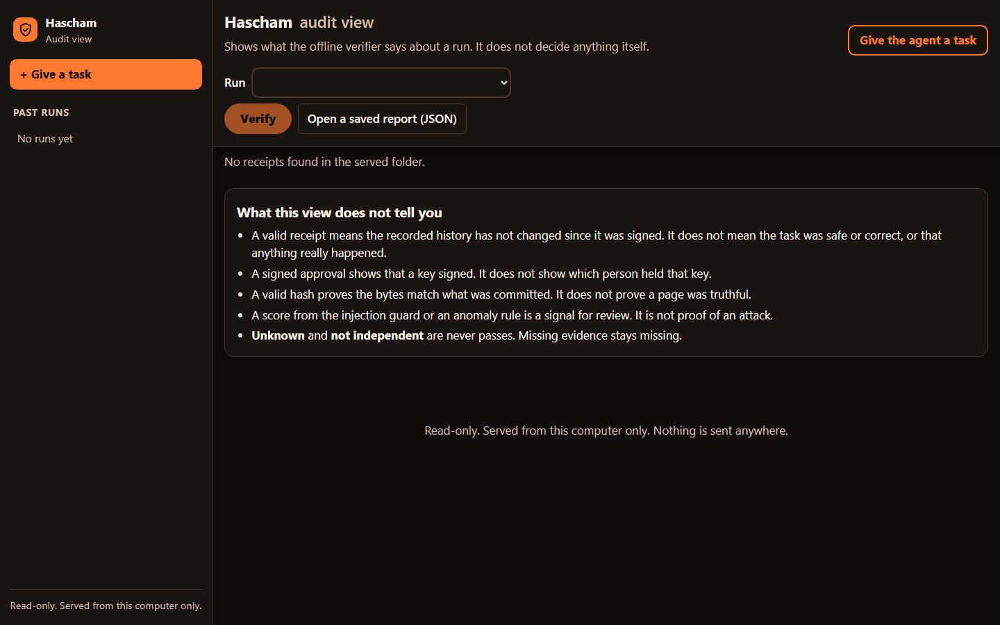
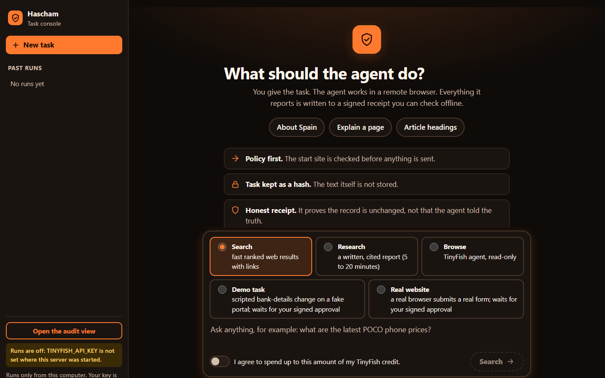

# Hascham (Agent Black Box)

A flight recorder for AI agents. Every step an agent takes goes through a policy gateway, risky steps wait for a person's **signed approval**, and the whole run is written to a **signed, tamper-evident receipt** that anyone can verify offline.

It is an evidence and auditing system. A valid receipt shows that the recorded history has not changed since it was signed. It does **not** show that an agent was honest, or that a real-world action really happened.

| The audit view | The task page (chat board) |
|---|---|
|  |  |

*Both screenshots show a fresh copy with no runs. The amber note on the task page is the real state of a copy with no TinyFish key set.*

## What it does

- **Signed receipts and an offline verifier** (Rust). Canonical JSON (RFC 8785), SHA-256, an RFC 6962-style Merkle tree and Ed25519 checkpoints. `abb verify` reports sixteen separate dimensions and never turns missing evidence into a pass.
- **A policy gateway.** Allowed hosts, action types, limits, and "needs approval" rules are decided deterministically before an action is sent.
- **Signed approvals and mandates.** A person signs with `abb approve`; the gateway relays the signature, and the verifier checks it again offline. A signed mandate can say what an agent may do at all.
- **Hidden fields.** A value such as a card number can be committed to without being stored, and shredded later.
- **Adapters.** A scripted replay adapter, a real-browser Playwright adapter whose coverage claim (`STEP_GATED`) is declared only after a bypass test battery passes, and optional TinyFish adapters (Browse, Search, Research) that are capped at `STEP_OBSERVED`.
- **Two pages** (plain HTML, served from your own computer): an audit view of receipts and a chat-style task page with a sign-and-approve card.

## What has been measured, and what has not

| Claim | Status |
|---|---|
| Receipt format, verifier, vectors | `TESTED`: 252 Rust tests and 190 conformance vectors pass |
| Python services, gateway, approvals, adapters, pages | `TESTED`: 549 pass in one full run (about 22 minutes), including end-to-end runs with real signing and a real browser |
| Approval gate on a real website (a real Chromium, `httpbin.org`) | `MEASURED` by hand twice: a granted approval let the form through, a denial sent nothing; both receipts verified. Automated test uses a local site |
| TinyFish Browse (cost = steps x $0.016) | `MEASURED` on real runs. Some tasks sat at 0 steps until cancelled; cause unknown |
| TinyFish Search and Research | `UNVERIFIED` live with this project's client. Search's response shape was checked against a real answer |
| Independent witnesses and anchors | `UNVERIFIED`: everything ran on one machine, so the verifier reports `NOT_INDEPENDENT` |
| Docker Compose stack | `UNVERIFIED`: never run |

Not covered: WebRTC and other non-HTTP transports, DNS rebinding between check and fetch, which person held a signing key (a signature shows a key signed), and any real money. The project's rules forbid real-money payments.

## Run it

Needs Rust, Python 3.11 or newer with `requirements-dev.txt`, PostgreSQL (for the signed ledger), and Chromium for the browser tests (`python -m playwright install chromium`).

```bash
cargo build --manifest-path core/Cargo.toml          # builds abb and abb-signer
cargo test  --manifest-path core/Cargo.toml          # Rust tests
abb vectors check                                    # conformance vectors
pytest -q                                            # Python tests (set ABB_BIN, ABB_SIGNER_BIN, ABB_TEST_DSN)
python tools/demo.py --dsn postgresql://USER@127.0.0.1:5432/postgres    # the end-to-end demo
python tools/ui_server.py --receipts <dir> --enable-runs                # the two pages, on http://127.0.0.1:8765
```

### Use a separate test PostgreSQL, not a database you care about

This matters. The tests and the demos need a PostgreSQL server, named by `ABB_TEST_DSN` (an admin
connection string such as `postgresql://USER@127.0.0.1:5432/postgres`), and they **create databases
on it**:

- every test and every run that records a receipt creates its own throwaway database, so the user in
  the string needs the `CREATEDB` permission;
- the tests drop only the databases they created. The demos and the pages' runs (`abb_demo_<random>`)
  are **not** dropped, so they pile up until you remove them;
- nothing here touches your other databases, but there is no reason to point it at a server that holds
  real data. Start a disposable local one instead, for example on its own port:

  ```bash
  initdb -D ./pgdata -U abb --auth=trust
  pg_ctl -D ./pgdata -o "-p 55432 -c autovacuum=off -c max_connections=200" -l pg.log start
  # then: ABB_TEST_DSN=postgresql://abb@127.0.0.1:55432/postgres
  ```

  `--auth=trust` is only for a throwaway server on this computer. On Windows the author twice saw a
  test server stop answering (error 487); stopping it with `pg_ctl stop -m immediate` and starting it
  again fixed it. Never stop other PostgreSQL processes on the machine.
- Only the audit view of existing receipts needs no database: it needs just the `abb` binary.

`start_hascham.bat` is a launcher written for the author's Windows machine (its paths are specific to it). To use a TinyFish mode, set `TINYFISH_API_KEY` in the environment of the server yourself. The key is read only from that variable and is never printed, logged or stored.

## Documents

Start with [`docs/README.md`](docs/README.md). The byte-level rules are in [`docs/PROTOCOL.md`](docs/PROTOCOL.md), which wins over every other document. What each mode shows, and what it does not, is in [`docs/DEMO.md`](docs/DEMO.md); the TinyFish findings are in [`docs/TINYFISH_SPIKE.md`](docs/TINYFISH_SPIKE.md); the plan and the claims ledger are in [`docs/IMPLEMENTATION_PLAN.md`](docs/IMPLEMENTATION_PLAN.md).

## Security

No secret is in this repository: keys, tokens and `.env` files are ignored by `.gitignore`. If you find one, tell the author and rotate it. This is a prototype built for a hackathon, not a certified compliance product.
