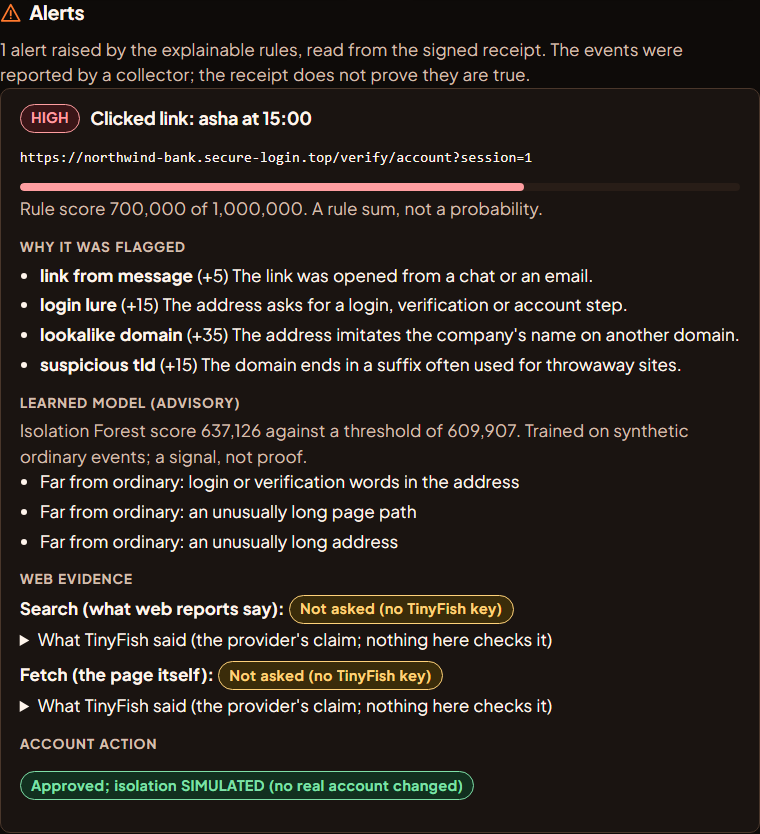

# Hascham (Agent Black Box)

A flight recorder for AI agents. Every step an agent takes goes through a policy gateway, risky steps wait for a person's **signed approval**, and the whole run is written to a **signed, tamper-evident receipt** that anyone can verify offline.

It is an evidence and auditing system. A valid receipt shows that the recorded history has not changed since it was signed. It does **not** show that an agent was honest, or that a real-world action really happened.

| The audit view | The task page (chat board) |
|---|---|
|  |  |

*Both screenshots show a fresh copy with no runs. The amber note on the task page is the real state of a copy with no TinyFish key set.*

**Pick what the agent should do** from the sidebar list (the task page on the right): Search, Research and Browse use TinyFish; Demo task, Endpoint review, Pay bills (local mock simulation) and Real website pause for your signed approval before anything sensitive happens.

**Alerts in the audit view** (a real signed run; TinyFish shows "not asked" because no key was set):



## What it does

- **Signed receipts and an offline verifier** (Rust). Canonical JSON (RFC 8785), SHA-256, an RFC 6962-style Merkle tree and Ed25519 checkpoints. `abb verify` reports sixteen separate dimensions and never turns missing evidence into a pass.
- **A policy gateway.** Allowed hosts, action types, limits, and "needs approval" rules are decided deterministically before an action is sent.
- **Signed approvals and mandates.** A person signs with `abb approve`; the gateway relays the signature, and the verifier checks it again offline. A signed mandate can say what an agent may do at all.
- **Hidden fields.** A value such as a card number can be committed to without being stored, and shredded later.
- **Adapters.** A scripted replay adapter, a real-browser Playwright adapter whose coverage claim (`STEP_GATED`) is declared only after a bypass test battery passes, and optional TinyFish adapters (Browse, Search, Research) that are capped at `STEP_OBSERVED`.
- **Two pages** (plain HTML, served from your own computer): an audit view of receipts and a chat-style task page with a sign-and-approve card.
- **Company-style payments with fake money.** An in-process local mock gateway simulates bill payments under a spend policy: up to 50.00 it pays on its own, over 50.00 up to 500.00 it waits for a person's signed approval (shown the amount and who is paid), over 500.00 is refused. No API key, external payment request, card details, or real money is involved.
- **Endpoint review (the deck's phishing-link scenario).** Reported endpoint events are sealed, scored by explainable rules (plus an optional Isolation Forest), explained in an **Alerts** section of the audit view, enriched with TinyFish Search and Fetch when a link is present, and an analyst signs before any (simulated) account isolation. A small opt-in collector can report real downloads, script launches and links on your own computer.
- **A graph of each run**, stored in FalkorDB (on this computer only) and drawn on the audit page: the run, its actions, which policy decided, which signed approval settled it. It is a picture made from the receipt, never a verdict; without FalkorDB it is drawn straight from the receipt and the page says so.

## What has been measured, and what has not

| Claim | Status |
|---|---|
| Receipt format, verifier, vectors | `TESTED`: 252 Rust tests and 190 conformance vectors pass |
| Python services, gateway, approvals, adapters, pages | `TESTED`: 549 pass in one full run (about 22 minutes), including end-to-end runs with real signing and a real browser |
| Approval gate on a real website (a real Chromium, `httpbin.org`) | `MEASURED` by hand twice: a granted approval let the form through, a denial sent nothing; both receipts verified. Automated test uses a local site |
| TinyFish Browse (cost = steps x $0.016) | `MEASURED` on real runs. Some tasks sat at 0 steps until cancelled; cause unknown |
| TinyFish Search and Research | `UNVERIFIED` live with this project's client. Search's response shape was checked against a real answer |
| Independent witnesses and anchors | The co-signing exchange between two folders is `TESTED` (`tools/remote_witness.py`). Independence is `UNVERIFIED`: it has not been tried on a second computer, so the verifier reports `NOT_INDEPENDENT` |
| Payments with fake money (local mock gateway) | Policy tiers, local simulated outcomes, gateway ordering, signed approvals and receipt verification are covered by automated tests. The payment provider is simulated in-process; no external payment API is called |
| Endpoint review: events, rules, alerts, evidence, signed decision | `TESTED` end to end with real signing and the real verifier. The events are **simulated** (or collected by the opt-in collector), the isolation is **simulated**, and TinyFish's answers are a scripted fake in the tests |
| Real opt-in collector (`tools/endpoint_daemon.py`) | `TESTED` on this computer: new files in one folder, script-shell launches, links from a file. Not a security product; sees only what it is pointed at |
| Isolation Forest (optional, scikit-learn) | `MEASURED` on **synthetic** labelled events only (`docs/MEASUREMENTS.md`): about 0.3 recall alone, more of the hard phishing cases with the rules. Not real-world performance |
| TinyFish Fetch | `TESTED` against a local fake that follows the documented API. `UNVERIFIED` live: run `python tools/check_tinyfish_live.py --fetch` |
| Artifact storage on an S3-compatible server (the deck's MinIO slot) | `TESTED` against SeaweedFS 4.48. **MinIO itself is not used**: its community edition was archived in April 2026 |
| Run graph in FalkorDB | `TESTED` against a real FalkorDB (round trip, replace, query-injection text stored as text) and on real receipts. The database has no password and relies on its 127.0.0.1-only binding |
| Docker Compose stack (`core` profile) | `MEASURED` once on 2026-10-18: healthy, API answers and refuses unauthenticated calls, database and signer not published, API holds no signing key. Not tested: a full signed run through the containers, digest pinning of every image, key restore |

Not covered: WebRTC and other non-HTTP transports, DNS rebinding between check and fetch, which person held a signing key (a signature shows a key signed), and any real money. The project's rules forbid real-money payments.

## Run it

Needs Rust, Python 3.11 or newer with `requirements-dev.txt`, PostgreSQL (for the signed ledger), and Chromium for the browser tests (`python -m playwright install chromium`).

```bash
cargo build --manifest-path core/Cargo.toml          # builds abb and abb-signer
cargo test  --manifest-path core/Cargo.toml          # Rust tests
abb vectors check                                    # conformance vectors
pytest -q                                            # Python tests (set ABB_BIN, ABB_SIGNER_BIN, ABB_TEST_DSN)
python tools/demo.py --dsn postgresql://USER@127.0.0.1:5432/postgres    # the end-to-end demo
python tools/ui_server.py --receipts <dir> --enable-runs                # the two pages, on http://127.0.0.1:8765
python tools/ui_server.py --receipts <dir> --falkordb redis://127.0.0.1:6390   # also keep the run graph in FalkorDB (deploy/README.md)
```

### Use a separate test PostgreSQL, not a database you care about

This matters. The tests and the demos need a PostgreSQL server, named by `ABB_TEST_DSN` (an admin
connection string such as `postgresql://USER@127.0.0.1:5432/postgres`), and they **create databases
on it**:

- every test and every run that records a receipt creates its own throwaway database, so the user in
  the string needs the `CREATEDB` permission;
- the tests drop only the databases they created. The demos and the pages' runs (`abb_demo_<random>`)
  are **not** dropped, so they pile up until you remove them;
- nothing here touches your other databases, but there is no reason to point it at a server that holds
  real data. Start a disposable local one instead, for example on its own port:

  ```bash
  initdb -D ./pgdata -U abb --auth=trust
  pg_ctl -D ./pgdata -o "-p 55432 -c autovacuum=off -c max_connections=200" -l pg.log start
  # then: ABB_TEST_DSN=postgresql://abb@127.0.0.1:55432/postgres
  ```

  `--auth=trust` is only for a throwaway server on this computer. On Windows the author twice saw a
  test server stop answering (error 487); stopping it with `pg_ctl stop -m immediate` and starting it
  again fixed it. Never stop other PostgreSQL processes on the machine.
- Only the audit view of existing receipts needs no database: it needs just the `abb` binary.

The author starts it with a private Windows launcher that is not in this repository (its paths are specific to one machine). To use a TinyFish mode, set `TINYFISH_API_KEY` in the environment of the server yourself. The key is read only from that variable and is never printed, logged or stored.

## Documents

Start with [`docs/README.md`](docs/README.md). The byte-level rules are in [`docs/PROTOCOL.md`](docs/PROTOCOL.md), which wins over every other document. What each mode shows, and what it does not, is in [`docs/DEMO.md`](docs/DEMO.md); the TinyFish findings are in [`docs/TINYFISH_SPIKE.md`](docs/TINYFISH_SPIKE.md); the plan and the claims ledger are in [`docs/IMPLEMENTATION_PLAN.md`](docs/IMPLEMENTATION_PLAN.md). Every code folder has its own `README.md` with a status line, and the local server's API is in Part E of [`docs/DATABASE_AND_API_CONTRACTS.md`](docs/DATABASE_AND_API_CONTRACTS.md).

## Security

The whole project is about security, so here is what it protects, how that is tested, and what it does not cover. The full threat model is in [`docs/SECURITY.md`](docs/SECURITY.md).

### What it protects

| Protection | How it works | How it is checked |
|---|---|---|
| **Tampering with history is caught** | Events are canonical JSON, hashed with SHA-256 into a Merkle tree. A separate signer process signs checkpoints with Ed25519. The offline verifier re-checks everything | Tests edit an event, swap an artifact, forge an approval and delete a whole run; each is caught |
| **Policy decides before an action is sent** | A deterministic gateway answers allow, deny or needs-approval first. Scores from the prompt guard or anomaly rules are advice only and can only make a decision stricter | Policy and gateway tests, with rules broken on purpose to confirm a test fails |
| **Risky steps need a person's signature** | The approval is signed with a key the ledger API and the signer never hold. `abb approve` refuses unless the text shown hashes to what is signed. An approval is for one action and expires | End-to-end tests with real signing: a grant lets the step through; a denial, silence or no approver does not |
| **The browser adapter can't be bypassed quietly** | Every request, including redirects and WebSockets, goes through the gateway first, with checks against local and private addresses. `STEP_GATED` is claimed only after a battery of 14 bypass probes passes | The probe site's own request log proves what reached the network. The battery found a real hole once; it was fixed and pinned by a test |
| **Secrets stay out of sight** | The signer key never reaches the API, worker or adapters. The TinyFish key comes only from an environment variable and is sent only to TinyFish. Hidden fields are salted commitments that can be shredded | Tests check the key never reaches the page, a command line or an error message |
| **The local pages are hardened** | Served on `127.0.0.1` only. Starting or approving a run needs a random token from the page, a loopback `Host` and `Origin`, one run at a time, and a time limit. Answers are shown as text, never as markup, and links open with `noopener` | Tests for each guard |

### What it does not protect against

- A valid receipt means the record is unchanged. It does **not** mean an agent was honest or that an action really happened.
- A signature shows a key signed, not which person held it. In this prototype the approver key sits on the same machine.
- Rolling the whole history back needs independent witnesses and anchors. They ran on one machine here, so the verifier says `NOT_INDEPENDENT`.
- Agents on someone else's servers, like TinyFish, can't be held back for approval. They get an "observed" record only.
- Not covered: WebRTC and other non-HTTP transports, and DNS rebinding between check and fetch.
- The local server checks the loopback `Host` header only on the run-console routes, not on the read routes (`docs/SECURITY.md` section 16). The graph database has no password and relies on its `127.0.0.1`-only port.
- It has not had an outside security review and is not a certified compliance product. It was built for a hackathon.

### Secrets and reporting

No secret is in this repository. Keys, tokens and `.env` files are ignored by `.gitignore`, and GitHub secret scanning with push protection is on. If you find a secret or a vulnerability, please open a GitHub issue **without pasting the secret**. A private reporting channel is not set up yet.
