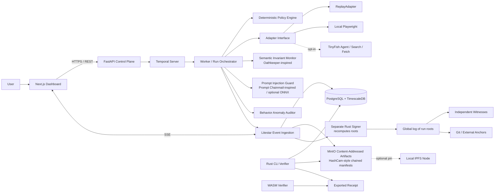

# Agent Black Box — Final Zero-Budget Architecture (v10)
**Status:** Final target architecture; implementation and security claims remain unverified until tests pass  
**Date:** 2026-10-15  
**Supersedes:** v9. Changes from the architecture review are listed in section 0 and marked **[v10]** in the text. Detail lives in `PROTOCOL.md`, `DESIGN.md` and `REQUIREMENTS.md` (draft 0.2).  
**Deployment target:** Self-hosted Docker Compose, local-first, no mandatory paid service  
**Product:** Evidence and behavioral auditing for bounded web-agent executions

---

## 0. Changes in v10 (from the architecture review)

| # | Change | Why | Sections |
|---|---|---|---|
| 1 | **Global log of run roots.** Every finalized run's last checkpoint is appended to one global log; witnesses and anchors cover it. | A per-run tree cannot show that a whole run was deleted. | 8, 10, 16 |
| 2 | **Salted field commitments.** Sensitive fields are stored as `hash(salt, value)`; the clear value and salt live outside the ledger. | Redaction and deletion rights without breaking proofs; also gives selective disclosure. | 7, 11, 16 |
| 3 | **Signer recomputes the root** from the canonical event bytes and a stored Merkle frontier. It never signs a caller-supplied root. | v9's "authenticated append record" left the trust link vague. | 9 |
| 4 | **Hackathon cut.** One FastAPI service, plain PostgreSQL, a Postgres lease and fencing token, Rust CLI first. Litestar split, TimescaleDB, Temporal, IPFS and WASM are deferred behind interfaces. The protocol does not change. | Scope. | 2, 21 |
| 5 | **Coverage story.** Local Playwright is the gated path. Remote adapters (TinyFish) are capped at `STEP_OBSERVED` without test evidence. For `STEP_GATED`, every dispatch needs an earlier authorization. | Honest claims. | 6, 13 |
| 6 | **Witness independence.** `failure_domain` labels; same-domain witnesses give `NOT_INDEPENDENT`. Minimum anchor is an append-only public Git file. | Same-machine witnesses are not independent. | 10, 16 |
| 7 | **Signed approvals and optional signed mandate.** Approvers sign on their own device. | Proves who allowed what. | 7, 16 |
| 8 | **Prompt guard is deterministic by default.** The classifier is off until a license review. | BSL 1.1 risk. | 15A.C |
| 9 | **Anomaly auditor is a stretch goal.** The demo does not depend on it. | No labeled data. | 15, 21 |
| 10 | **Required vs optional verifier dimensions per profile.** `INCOMPLETE` means a required item is missing; `PARTIAL` means only an optional one is. Adds `global_log_inclusion` and `mandate_compliance`. Replay drift is an advisory check. | The two results overlapped. | 15, 16 |

Items 1, 2, 3 and 7 go beyond v9 or change its signer flow. They can be dropped item by item, but 1 and 3 change the checkpoint and signer protocol.

---

## 1. Executive decision

Agent Black Box records what an automation run claims to have done, applies deterministic policy checks, optionally analyzes behavior with ML, and produces a receipt whose integrity can be checked independently.

The architecture has two operating profiles:

- **LOCAL_ONLY (default):** all core execution, event recording, cryptography, storage, and verification run locally. TinyFish, public anchors, and remote witnesses are disabled. This profile remains useful without internet access after images/models are downloaded.
- **CONNECTED_EVIDENCE (opt-in):** enables TinyFish Search/Fetch or Agent runs, plus optional independent witnesses and external anchors. External services are adapters, never a requirement for core operation or receipt verification.

The system must not claim that a cryptographically valid receipt proves that an external browser action really happened. It proves that the signed event history has not been altered relative to trusted checkpoints and records the declared source and coverage of observations. Stronger execution claims require trustworthy observation or independent attestation.

## 2. Requirements and final stack

| Concern | Final choice | Notes |
|---|---|---|
| Web UI | Next.js + React + TypeScript, Tailwind CSS, shadcn/ui | Dashboard, run explorer, policy view, receipt viewer |
| API/control plane | FastAPI | Auth, run lifecycle, policy decisions, receipt endpoints |
| High-throughput event ingestion | Litestar | Dedicated ingestion service; benchmark before tuning. **[v10]** Hackathon cut: an ingestion module inside the one FastAPI service first |
| Durable orchestration | Self-hosted Temporal | Durable workflows, retries, timers, cancellation and recovery. **[v10]** Hackathon cut: Postgres lease and fencing token first; the same safety rules apply |
| Execution adapters | ReplayAdapter first; local Playwright; optional TinyFish | Replay is deterministic and default; TinyFish requires explicit opt-in |
| ML/security analysis | Python, scikit-learn + optional ONNX runtime | Semantic invariant monitoring, prompt-injection detection, and behavior anomaly detection; advisory-only |
| Cryptographic core | Rust library + CLI | RFC 8785 JCS, SHA-256 Merkle tree, Ed25519 |
| Database | PostgreSQL + open-source TimescaleDB extension | Keep protocol-critical rows relational; use hypertables only for suitable time-series telemetry. **[v10]** Hackathon cut: plain PostgreSQL |
| Artifact storage | Self-hosted MinIO | Content-addressed objects, retention and lifecycle controls |
| Optional content distribution | Local IPFS node(s) | Optional pinning/distribution; not the source of truth. **[v10]** Deferred in the hackathon cut |
| Live UI updates | Server-Sent Events (SSE) | Replayable stream using event IDs / `Last-Event-ID` |
| Browser verifier | Rust core compiled to WebAssembly | Same verification logic as CLI; CLI/offline verifier remains authoritative. **[v10]** WASM deferred; CLI first |
| Local LLM | Optional Ollama profile | Not required for baseline execution or security decisions |
| Deployment | Docker Compose | Pinned images, health checks, resource limits, persistent volumes and backups |

**Zero-budget interpretation:** the project incurs no required hosted-service bill. Self-hosting still uses hardware, electricity, disk, bandwidth, and maintenance time. TinyFish is an optional credit-consuming external dependency; budget guards must prevent accidental spend.

## 3. System context and component diagram

The diagram describes logical responsibilities, not a claim that the containers or integrations are already implemented.

## 4. Trust boundaries

1. **Browser/UI:** untrusted presentation layer. It may display a false result if compromised; it does not decide whether a receipt is valid.
2. **FastAPI control plane:** authenticates users and requests, creates runs, evaluates request-level policy and coordinates workflows. It cannot access the signer’s private key.
3. **Litestar ingestion:** validates event schemas, sequence numbers, idempotency, authorization, and canonical encoding. It is the sole normal writer of committed event rows.
4. **Worker/adapter:** untrusted with respect to ledger integrity. It proposes observations and artifacts; it cannot rewrite committed events or call the signer with arbitrary roots.
5. **Signer:** separate process/container with a dedicated key volume and narrow authenticated API. It has no general database credentials. **[v10]** It receives the canonical event bytes, recomputes the root from its own Merkle frontier and validates sequence and encoding before signing; it never signs a root supplied by the caller. It cannot know the events are true.
6. **Database/object store:** durable but not inherently immutable against a host administrator. Cryptographic checkpoints, independent witnesses, and anchors help detect rollback or tampering.
7. **External adapters/witnesses/anchors:** outside the strict local trust boundary. Their outputs are labeled by provenance and are never silently treated as independent if they share the same administrator or machine.

## 5. Run lifecycle and event flow

1. User creates a run with a declared task, adapter, policy version, and requested coverage level.
2. FastAPI validates the request and records a run intent; Temporal starts the durable workflow.
3. Worker acquires a run lease/fencing generation and evaluates the deterministic policy.
4. Adapter executes a bounded task. Each observed or gated action is submitted as a proposed event; artifacts are uploaded to MinIO by the designated artifact path.
5. Litestar validates and commits events transactionally, assigning a unique `(run_id, sequence)` and idempotency key. SSE only publishes committed events.
6. ML auditor analyzes available metadata after or during the run. Its output is advisory and separately recorded.
7. Finalization freezes the run’s event prefix, computes a Merkle root, and asks the signer to verify the extension from the previous checkpoint.
8. Signer persists its state before returning a signature. Checkpoint publication, witnesses, and external anchors follow the selected profile.
9. Receipt exporter bundles canonical events or their hashes, checkpoint(s), signatures, inclusion/consistency proofs, artifact digests, provenance, coverage, and verification metadata.
10. Rust CLI and WASM verifier independently validate the receipt. The browser verifier must not be the only way to check a receipt.

### Run states

`PENDING → POLICY_CHECKED → DISPATCHED → OBSERVING → ANALYZING → FINALIZING → CHECKPOINTED → EXPORTED`

Terminal/exception states: `FAILED`, `OUTCOME_UNKNOWN`, `CANCELLED`, `POLICY_BLOCKED`.

- Never blindly retry an irreversible action after a worker crash.
- If a remote call may have succeeded but the response was lost, record `OUTCOME_UNKNOWN` and reconcile before retrying.
- Temporal retries must use idempotency keys and adapter-specific retry rules.
- Database-backed worker state must use lease expiry plus a monotonically increasing fencing token. A stale worker must not commit after a newer worker takes over.
- Define and test all legal state transitions; reject invalid transitions at the database/service boundary.

## 6. Coverage levels and truthful claims

| Level | Meaning | Safe claim |
|---|---|---|
| `TASK_LEVEL` | Task request and reported result are retained | Task-level reporting only |
| `STEP_OBSERVED` | Adapter supplies per-step observations, which are recorded with provenance | Observed steps were recorded; not every action is necessarily intercepted |
| `STEP_GATED` | Every in-scope action passes through the policy gateway before dispatch, with an authorization/blocked record | Gated actions are policy-checked before execution, within the declared boundary |

- ReplayAdapter is deterministic simulation and must always be labeled `REPLAY` / `SIMULATED`.
- Local Playwright can support `STEP_GATED` only if all in-scope actions, including navigation, clicks, form submission, downloads, and relevant network requests, are actually mediated by the gateway. Otherwise downgrade the declared coverage.
- TinyFish coverage depends on the exact API evidence and control points available for the specific operation. Never infer `STEP_GATED` from a final answer or a list of reported steps.
- Missing evidence is `UNKNOWN` or `INCOMPLETE`, not proof that an action did not occur.
- **[v10]** Any `LIVE_EXTERNAL` run is capped at `STEP_OBSERVED` unless a recorded capability-test report proves pre-dispatch gating. For declared `STEP_GATED`, every `ACTION_DISPATCHED` must have an earlier `ACTION_AUTHORIZED` for the same action; the verifier checks this.
- **[v10]** Product story: gate local agents, observe remote ones, and let the receipt say which.

## 7. Event protocol and canonical encoding

The protocol must be frozen in `docs/PROTOCOL.md` before production receipts are emitted.

### Canonical JSON

- Use RFC 8785 JSON Canonicalization Scheme (JCS), with conformance vectors in the repository.
- Restrict protocol numbers to integers in the exactly representable range `[-(2^53-1), +(2^53-1)]`. Reject floats, NaN, infinities, and ambiguous number representations.
- Define UTF-8 encoding, Unicode handling, required fields, optional-field behavior, maximum payload sizes, and schema versioning.
- Store the exact canonical byte sequence. Do not rely on reserializing PostgreSQL `JSONB` to recover signed bytes.

### Hashing and domain separation

- Use SHA-256 with explicit, versioned domain tags for event leaves, internal nodes, checkpoint signing payloads, artifacts, and protocol identifiers.
- The precise bytes for each domain tag and field encoding must be specified in `docs/PROTOCOL.md` and covered by cross-language test vectors.
- Hash raw artifact bytes; metadata contains the digest, media type, size, and capture provenance.

### Event types

At minimum: `RUN_STARTED`, `COVERAGE_DECLARED`, `ACTION_REQUESTED`, `ACTION_AUTHORIZED`, `ACTION_BLOCKED`, `ACTION_DISPATCHED`, `BROWSER_OBSERVATION`, `API_CALL_OBSERVED`, `ARTIFACT_CAPTURED`, `POLICY_VIOLATION_DETECTED`, `ACTION_SUCCEEDED`, `ACTION_FAILED`, `OUTCOME_UNKNOWN`, `HUMAN_APPROVAL_REQUESTED`, `HUMAN_APPROVAL_GRANTED`, `HUMAN_APPROVAL_DENIED`, `ML_ANALYSIS_COMPLETED`, `SEMANTIC_INVARIANT_CHECKED`, `SEMANTIC_VIOLATION_DETECTED`, `PROMPT_SECURITY_ANALYSIS_COMPLETED`, and `RUN_FINISHED`.

**[v10] Field commitments.** Sensitive payload fields chosen by redaction policy are replaced by `SHA-256("ABB1-FIELD" || 0x00 || salt || JCS(value))` with a 16-byte random salt per field per event. Salts and clear values are kept outside the ledger; deleting a salt (crypto-shredding) does not break any hash, proof or signature. Receipts may disclose a field by including its salt and value. Hidden values do not hide the event's existence, type, timing or size.

**[v10] Signed approvals.** `HUMAN_APPROVAL_GRANTED` and `_DENIED` carry an Ed25519 signature over an approval statement (run, action, summary digest, decision, expiry) made on the approver's own device. The control plane never holds approver keys. A signed approval proves a key signed, not which human held it.

**[v10] Optional mandate.** `RUN_STARTED` may reference a signed mandate (allowed hosts, action types, action count, spend limit, validity window). The gateway uses it as a deterministic policy input and the verifier re-checks it (`mandate_compliance`).

`CHECKPOINT_CREATED` must not embed the root or signature of a checkpoint whose root includes that same event. Prefer checkpoint publication as protocol metadata outside the event stream; otherwise define the event as a non-self-referential marker.

## 8. Merkle tree, checkpoints, and signatures

- Select one exact protocol version: implement the RFC 6962 Certificate Transparency Merkle Tree Hash construction or explicitly adopt RFC 9162 where appropriate. Do not describe a custom hybrid as simply “RFC-compliant.”
- Define empty-tree behavior, tree split/shape, leaf and node hashing, inclusion proofs, consistency proofs, stream identity, genesis checkpoint, and malformed-proof rejection.
- Use domain-separated Ed25519 signatures over a canonical checkpoint signing payload containing at least: protocol version, stream/run identity, tree size, root hash, previous checkpoint hash, key ID, and creation time.
- A timestamp is a claim unless backed by a separately verified trusted timestamp service.
- Key rotation must include old-key authorization, new-key activation, and a verifiable transition record. Verification keys must be distributed out of band or via an independently trusted key manifest.
- Use the same Rust core for the signer, CLI verifier, and WASM verifier. Cross-language wrappers must not reimplement cryptographic rules independently.

### Global log of run roots **[v10]**

All finalized runs are also appended to one global log (stream `global`), built with the same tree rules. A leaf is the run's final checkpoint reference (run ID, checkpoint hash, tree size, root, manifest head, finalized time) under its own domain tag. The signer appends a run root only for a checkpoint it signed itself. Witnesses and anchors sign and publish **global** checkpoints. A receipt carries the run's global inclusion proof, and a run reaches `EXPORTED` only after a global checkpoint covers it. `abb verify-global` recomputes the global root from the run roots in the database and compares it with the latest witnessed or anchored global checkpoint, so a deleted or altered run is detected. Not detected: a run deleted before it is appended, or a rollback that also removes every witness and anchor.

## 9. Signer and anti-rollback design

The signer runs in a separate container/process with a dedicated persistent key volume. Private keys are not mounted into FastAPI, Litestar, worker, dashboard, or general-purpose containers.

### Signer request validation

**[v10]** A signing request carries the stream identity, the previously signed checkpoint, the canonical bytes of the new events (and manifest entries), an optional expected root for cross-checking, and an authentication from the ingestion service. The signer keeps a Merkle frontier per stream, hashes the new leaves and computes the new size and root itself. It must not sign a caller-provided root or list of leaf hashes. For the global stream, each run root must match a checkpoint in the signer's own state log.

The signer must:
- validate strict canonical encoding, protocol version, run identity, consecutive sequence from its own tree size, known event types and size limits, and that nothing follows `RUN_FINISHED`;
- verify that the proposed tree extends the signer’s own last accepted checkpoint;
- reject smaller/equal tree sizes unless an explicitly defined idempotent replay of the identical checkpoint is being returned;
- reject non-extending roots, forked histories, unknown streams without a valid genesis, malformed proofs, duplicate or missing sequences, and invalid authorization;
- persist the new state durably before returning a successful signature;
- fail closed if state is corrupt and require an explicit recovery ceremony rather than silently resetting;
- rate-limit and audit signing requests.

### State and key handling

- Keep a hash-chained append-only signer state log containing stream ID, tree size, root, checkpoint hash, key ID, and transition metadata.
- Generate keys offline where feasible; keep an encrypted offline backup and document tested restore/rotation procedures.
- A single signer detects edits relative to its retained state but cannot independently defeat compromise of its host and all backups. Independent witnesses/anchors reduce this risk.
- **[v10]** The signer proves well-formed, ordered events extending its previous state. It does not prove the events are true; a compromised ingestion service can still submit false but well-formed events. The defenses are the gateway (observation), witnesses and anchors.

## 10. Witness quorum and anchors

Define the quorum unambiguously. Example: **3 witness identities total, quorum 2-of-3**, where the primary signer is one identity only if the threat model explicitly counts it as a witness. Otherwise use **2-of-3 independent witnesses in addition to the primary signer**. Never mix these interpretations.

- Each witness must have separate key material and persistent anti-rollback state.
- **[v10]** Witnesses sign global checkpoints. The signer and each witness carry a `failure_domain` label (for example `host:laptop-a/admin:alice`). Witnesses that share a domain with each other or with the signer make `witness_quorum` report `NOT_INDEPENDENT`, never `PASS`. The cheapest real independence is a second device.
- For an independence claim, document different administrators/devices or explain that identities share a failure domain.
- Witnesses independently verify checkpoint extension and sign a checkpoint digest; they do not blindly cosign.
- `LOCAL_ONLY` can verify local signatures and retained signer history but cannot claim external anti-rollback protection against full host rollback.
- `CONNECTED_EVIDENCE` may publish checkpoint digests to a public Git repository, another administrator’s repository, or a verified public transparency/timestamp service. Treat availability and terms as external dependencies.
- Git commit timestamps are not trusted timestamps by themselves.
- Anchors are out-of-band metadata, not ordinary run events.
- **[v10]** Minimum anchor: an append-only file in a public Git repository, one line per global checkpoint (size, hash, publication time). An anchor in the same administrator's repository as the signer is reported `NOT_INDEPENDENT`.

## 11. Data and artifact storage

### PostgreSQL + TimescaleDB

Use PostgreSQL for transactional run state, users, policies, event metadata, idempotency, workflow references, checkpoints, and signer/witness records. Use TimescaleDB hypertables only for suitable high-volume time-series telemetry, not automatically for the core event ledger.

Suggested logical tables:
- `runs`
- `run_state_transitions`
- `event_stream_heads`
- `events` (unique `(run_id, sequence)` and `event_id`)
- `event_idempotency`
- `artifacts`
- `policies` / `policy_versions`
- `ml_assessments`
- `checkpoints`
- `witness_signatures`
- `anchor_publications`
- `workflow_outbox`

Requirements:
- One serialized writer per run. Lock `event_stream_heads` using `SELECT ... FOR UPDATE` in the same transaction that commits the next sequence and event.
- Commit event row, sequence/head update, and outbox entry atomically.
- SSE reads only committed events and supports replay using `Last-Event-ID`.
- App roles are least-privilege; the ingestion service owns normal committed event writes. These permissions do not prevent a database administrator from rewriting data, which is why checkpoints and independent anchors matter.
- Test deletion, modification, transaction rollback, backup restore, and whole-database rollback scenarios.
- Review TimescaleDB extension edition/licensing and index/constraint behavior against the selected version before adopting hypertables. Keep the protocol ledger in ordinary PostgreSQL tables if any extension constraint complicates required uniqueness.

### MinIO and optional IPFS

- Store artifacts in MinIO under content-addressed object keys derived from SHA-256; retain metadata and digest in PostgreSQL.
- Verify content digest after upload and before export/download.
- Use versioning/object-lock features only after validating the selected edition and licensing; do not assume immutability settings protect against host administrators.
- Upload via a single designated artifact component. Workers submit artifacts or a controlled upload request; they cannot overwrite arbitrary objects or mutate committed artifact metadata.
- Use temporary upload, checksum verification, and atomic metadata finalization. Define cleanup of abandoned uploads.
- IPFS is optional for pinning or distribution. A CID is a locator/content identifier, not a substitute for the signed receipt or a guarantee of availability. The local system must work without IPFS.

## 12. Services and API responsibilities

### FastAPI — control plane
- Authentication and authorization
- Run creation/cancellation and policy version selection
- Temporal workflow start/query
- Receipt export and verification job endpoints
- Budget guard and TinyFish opt-in controls
- Never expose signer private keys

### Litestar — event ingestion and SSE
- Schema and size validation
- Authenticated adapter/worker event intake
- Idempotency, sequence assignment, transactional commit/outbox
- SSE delivery of committed events with replay support
- Rate limits and backpressure
- No direct signing-key access

### Temporal — durable orchestration
- Run lifecycle and timers
- Retries only where safe and idempotent
- Heartbeats, cancellation, and recovery
- Activities must be idempotent; ambiguous irreversible outcomes are reconciled, not blindly retried

### Worker and adapter contract
Every adapter returns a normalized result with:
`adapter_name`, `adapter_version`, `execution_id`, `requested_coverage`, `observed_coverage`, `started_at`, `finished_at`, `status`, `steps[]`, `artifacts[]`, `errors[]`, `external_usage`, and `provenance`.

The schema distinguishes `reported_by_adapter`, `observed_by_local_gateway`, and `verified_by_black_box`. Do not conflate provider-reported claims with locally observed facts.

## 13. TinyFish integration and $15 credit plan

TinyFish is an optional external adapter, not part of the strict self-hosted core. Support Search/Fetch and Agent through separate adapter methods and report actual provider usage where available.

### Budget policy
- Set a hard project-wide spend/credit ceiling based on actual provider metering, not guessed request counts.
- Before each run, require opt-in, estimate usage if the API supports it, and check remaining credits if the provider exposes that value.
- Stop launching optional calls at the configured reserve threshold. Do not silently fall back to a paid operation.
- Record operation type, provider execution ID, metering data returned by the API, and the time at which usage was observed.
- Credit availability and API quotas are volatile; the adapter must handle quota exhaustion gracefully.

### Initial $15 experimental allocation (planning limits, not provider price estimates)
| Purpose | Budget cap |
|---|---:|
| TinyFish Agent capability tests | $6 |
| Search/Fetch capability tests | $3 |
| Evidence validation and reruns | $3 |
| Unspent reserve | $3 |
| **Total** | **$15** |

First test API response structure and actual metering. Then run a few small, bounded tasks and compare TinyFish output with local Playwright and ReplayAdapter. Do not run broad crawls or uncontrolled agent loops.

Required capability spike:
- per-step records and identifiers;
- screenshots/HTML/artifact availability and retention;
- timestamp semantics;
- errors, cancellation, timeouts, and ambiguous outcomes;
- actual Search/Fetch and Agent credit consumption;
- API quotas and behavior when credits are exhausted;
- whether actions can be gated before execution;
- licensing/terms for retaining and exporting evidence.

Until proven by tests, classify TinyFish as `TASK_LEVEL` or `STEP_OBSERVED` according to actual evidence. Never label it `STEP_GATED` unless every in-scope action is verifiably gated before dispatch.

## 14. Deterministic policy engine

Policy decisions are deterministic, versioned, and separately recorded from ML assessments.

- Use allowlists/denylists, action constraints, domain restrictions, rate limits, human approval gates, and explicit high-risk action handling.
- Record policy ID/version, input digest, decision, reason codes, and approval reference.
- The policy engine must be in the execution path for `STEP_GATED`.
- ML scores must not override a deterministic deny or authorize an action.
- Policy changes are versioned; each run references the exact policy version used.

## 15. ML behavioral auditor

**[v10] Stretch goal.** There is no labeled data, so the first version is a rules baseline and the model comes after the core demo works. The auditor stays advisory and the acceptance criterion does not depend on it.

**[v10] Replay drift.** Rerun or replay a task and diff the normalized traces (actions added, removed or reordered, hosts, outcome). The result is an advisory behavior-anomaly record, not proof of malice.

Start with interpretable baselines before complex models.

### Candidate features
- step-count and action-count patterns;
- repeated loops and retry bursts;
- dwell-time distributions;
- navigation/reading/action ratios;
- action n-grams and unusual sequences;
- outcome and error patterns, if they are not policy-derived labels.

Do not use “policy violation” or “off-allowlist” as model input features when evaluating whether behavior is anomalous relative to policy; that creates circularity. Keep policy assessment and ML assessment separate.

### Evaluation
- Baseline: deterministic rules; compare with Isolation Forest and a supervised classifier only if labeled data is available.
- Split by scenario family and time, not random rows from the same execution family.
- Report precision, recall, false-positive rate, calibration where applicable, and performance by scenario.
- Explain that unsupervised anomaly scores are not probabilities unless calibrated.
- Use model/version/feature-schema identifiers and metadata-only ML results in receipts. Never pickle executable models into receipts.
- ML failure must not prevent cryptographic verification or change authorization decisions.

## 15A. Integrated security modules: Oathkeeper, HashCam, and Prompt Chainmail

These names refer to different kinds of systems. The architecture adopts their relevant concepts but does not assume they are all ML models.

### A. Oathkeeper-inspired semantic invariant monitor

This means the Oathkeeper research approach to detecting semantic violations from regression traces, not Ory Oathkeeper's identity-aware HTTP proxy.

**Goal:** detect when a task reports success despite violating the expected behavior of the workflow.

Inputs:
- scenario and invariant-set versions;
- normalized action/event trace;
- adapter provenance and declared coverage;
- known-good regression traces and negative test cases.

Implementation:
1. Start with explicit deterministic invariants authored from task requirements.
2. Build regression scenarios for each invariant, including known-good and known-bad traces.
3. Evaluate invariants against live traces and point to the exact event range that failed.
4. Treat missing/unobserved steps as `UNKNOWN`, never as a pass.
5. Only later experiment with mining candidate invariants from paired regression traces. Human-review inferred rules before enabling them.

Example invariants:
- success requires an observed postcondition, not just a model-generated success message;
- a destructive action requires approval before dispatch;
- an action reported as successful cannot have only a failed or unknown outcome event;
- declared `STEP_GATED` coverage requires evidence that the gateway intercepted every in-scope action.

Emit `SEMANTIC_INVARIANT_CHECKED` and `SEMANTIC_VIOLATION_DETECTED` events. Each finding stores invariant ID/version, severity, evidence event IDs, confidence/explanation, and status. A semantic finding can trigger a policy-defined escalation, but the monitor does not directly grant permissions.

### B. HashCam-style artifact provenance

This is cryptographic integrity, not ML. Implement it natively for browser screenshots, HTML snapshots, downloads, and permitted response bodies.

For each artifact:
1. Capture at a defined point and record run ID, event ID, adapter, capture method, MIME type, size, and timestamp claim.
2. Hash the exact artifact bytes with SHA-256.
3. Store the artifact in MinIO under a content-addressed object key.
4. Verify the digest after upload and on download/export.
5. Append a canonical manifest entry that contains the artifact digest and a reference to the previous manifest entry.
6. Bind the artifact-manifest head into the signed run checkpoint and exported receipt.
7. Verify the artifact digest and manifest linkage offline.

Keep the artifact manifest separate from the event Merkle tree: the manifest commits to captured files and their order; the Merkle tree supports event inclusion and consistency proofs. The checkpoint/receipt references both.

Limits: a hash proves that bytes match the committed digest, not that the screenshot is genuine or the page was truthful. A compromised capture process can fabricate evidence before hashing. A local timestamp is a claim unless independently timestamped. Do not claim absolute immutability.

### C. Prompt Chainmail-inspired prompt-injection guard

Use a layered input guard for untrusted page text, fetched documents, accessibility-tree content, and tool outputs before those contents are passed to the agent as context.

Pipeline:
1. Preserve a digest/reference to the original input and apply size limits.
2. Run deterministic checks for common injection patterns, role confusion, hidden instructions, and tool-use hijacking.
3. Optionally run a local ONNX classifier.
4. Emit `ALLOW`, `FLAG_FOR_REVIEW`, or `BLOCK_BY_POLICY` as a *signal* to the deterministic policy gateway, not as an authorization decision made by the model.
5. Record detector/model version, score, reason codes, source digest, and coverage.
6. If the classifier is unavailable, fall back to deterministic checks and clearly record that classifier coverage was unavailable.

**[v10] Default: deterministic checks only. The classifier is off unless enabled after a license review.** No Prompt Chainmail code or model is vendored; only the `classify(input) -> verdict, score, reasons` interface is kept. Receipts record `classifier_available = false` while it is off.

Prompt Chainmail's public repository describes its included classifier as development-quality and lists Business Source License 1.1 terms with a future Apache 2.0 conversion. Therefore, treat it as a candidate reference, not an automatically approved production dependency. Inspect the exact revision, model artifact, license, and release status before copying, vendoring, or shipping it. “Free to download” does not mean unrestricted production use. If licensing or quality is unsuitable, retain the adapter interface and choose a suitably licensed model or train/evaluate a local model.

Evaluate against benign hard negatives (security documentation, quoted prompt injections, code blocks, legitimate system-prompt examples) and attacks across the languages and content types the application supports. Report false positives and false negatives. The classifier must not be described as a complete prompt-injection solution.

### D. Keep assessment channels separate

The UI and receipt must show distinct outputs:
- `POLICY_ASSESSMENT`: deterministic allow/deny/approval outcome;
- `SEMANTIC_ASSESSMENT`: invariant checks against task behavior;
- `PROMPT_SECURITY_ASSESSMENT`: suspicious untrusted input findings;
- `BEHAVIOR_ANOMALY_ASSESSMENT`: unusual execution trajectory;
- `EVIDENCE_INTEGRITY`: cryptographic checks over events, artifacts, and checkpoints.

An anomaly is not proof of malicious behavior. A prompt-injection score is not proof an attack succeeded. A valid hash is not proof the captured content is truthful. High-risk findings may trigger a block or human approval only through explicit deterministic policy.

### E. Reference projects and boundaries

- Oathkeeper research paper (semantic invariant inference): https://www.usenix.org/sites/default/files/osdi22_full_proceedings_interior.pdf
- Ory Oathkeeper (separate identity-aware proxy, not an ML detector): https://www.ory.com/oathkeeper
- HashCam hash-chaining-camera reference: https://github.com/bochristopher/hash-chaining-camera
- Prompt Chainmail (prompt-injection middleware with optional offline ONNX classifier): https://github.com/prompt-chainmail/prompt-chainmail-ts
- CHAINMAIL on-chain communication project (distinct from Prompt Chainmail): https://www.chainmail.space/

These are reference points only; this architecture does not claim to have vendored or validated their code. The exact Oathkeeper, HashCam, and Chainmail projects must be confirmed before adopting any dependency.

## 16. Receipt format and verification statuses

A receipt should contain:
- protocol and schema versions;
- run ID, adapter identity/version, declared and observed coverage;
- canonical events or event hashes and the necessary proofs;
- checkpoint(s), signer key ID, signature, previous checkpoint reference, consistency/inclusion proofs;
- artifact digests and provenance;
- policy version and deterministic decisions;
- semantic invariant results and invariant-set version, if present;
- prompt-injection analysis metadata, detector/model version, score, reason codes, and source digest, if present;
- behavior-anomaly metadata and model version, if present;
- artifact-manifest head and proof, if present;
- witness signatures and anchor references, if available;
- export tool version and verification metadata.

Verifier outputs separate dimensions rather than one opaque boolean:
- `evidence_integrity`
- `checkpoint_signatures`
- `consistency`
- `artifact_availability`
- `witness_quorum`
- `anchor_match`
- `observation_coverage`
- `policy_assessment`
- `semantic_assessment`
- `prompt_security_assessment`
- `behavior_anomaly_assessment`
- `artifact_manifest_integrity`
- `ml_assessment` (aggregate display only; preserve the individual dimensions above)
- `execution_outcome`
- **[v10]** `global_log_inclusion`
- **[v10]** `mandate_compliance` (`NOT_APPLICABLE` without a mandate)

`witness_quorum` and `anchor_match` may also be `NOT_INDEPENDENT`.

**[v10] Required dimensions.** `LOCAL_ONLY` requires `evidence_integrity`, `checkpoint_signatures`, `consistency`, `global_log_inclusion`, `observation_coverage`, `policy_assessment`, plus `artifact_manifest_integrity` if artifacts exist and `mandate_compliance` if a mandate exists. `CONNECTED_EVIDENCE` also requires `witness_quorum` and `anchor_match`. The semantic, prompt-security, anomaly, ML and outcome dimensions are informational and never change the overall result by themselves.

Overall result:
- `VALID`: all required checks for the declared profile pass.
- `INVALID`: a cryptographic, structural, or policy-integrity check fails (any required dimension is `FAIL`, or a present witness signature does not verify).
- `INCOMPLETE`: a **required** dimension lacks evidence or artifacts.
- `UNSUPPORTED`: verifier does not support the protocol/version/adapter evidence.
- `PARTIAL`: everything required passes, but an **optional** check is unavailable or `NOT_INDEPENDENT`.

A valid signature does not mean a task was safe, correct, authorized, or actually executed as claimed. Those are separate dimensions.

## 17. Rust CLI and WebAssembly verifier

- Build one Rust verification core and expose it to CLI and WASM.
- CLI verifies locally exported receipts and is the independent reference implementation.
- WASM verifies a user-selected local receipt; enforce size limits, path traversal defenses, bounded decompression, safe parsing, and rejection of unknown critical fields.
- Pin dependencies and produce reproducible builds where practical.
- Subresource Integrity is useful but does not by itself defeat a compromised page that can alter both the script and its integrity reference. Provide a separately downloadable CLI or offline verifier build and publish its digest/key through an independent channel.
- Include test vectors for valid receipts, modified events, invalid signatures, invalid consistency proofs, missing artifacts, unknown versions, truncated files, and malformed input.

## 18. Threat model and limitations

### Designed to detect
- changes to retained canonical events after a trusted checkpoint;
- invalid signatures and malformed inclusion/consistency proofs;
- some rollback/fork attempts when signer state, independent witnesses, or external anchors remain trustworthy;
- artifact substitution when digests are checked;
- policy decisions that lack the required recorded approval/evidence.

### Not guaranteed to detect
- actions that were never observed by the adapter/gateway;
- a compromised execution host that fabricates observations before they enter the ledger;
- collusion or compromise of all signers/witnesses and their retained state;
- rollback when only one local machine and all its backups are rolled back together;
- the truth of a timestamp without a trusted timestamp source;
- correctness or safety of an agent’s outcome merely because its receipt verifies;
- external provider behavior beyond the evidence actually returned.

The product is an evidence and behavioral-auditing system, not a universal proof that an agent is honest or that a real-world action occurred.

## 19. Docker Compose and operations

Compose profiles:
- `core`: frontend, FastAPI, Litestar, worker, PostgreSQL/TimescaleDB, Temporal, signer, MinIO.
- `replay`: deterministic replay scenarios and test fixtures.
- `playwright`: local browser runner and browser dependencies.
- `tinyfish`: configuration for optional external TinyFish calls; no secrets committed to the repository.
- `ipfs`: optional local IPFS node.
- `llm`: optional Ollama model service.
- `testing`: test runner, CLI verifier, fault-injection and integration tests.

Operational requirements:
- Pin container images by immutable digest where feasible.
- Use health checks, startup ordering, migrations, resource limits, non-root users, and least-privilege service credentials.
- Keep signer key volume separate and do not mount it into other services.
- Restrict signer network ingress to authenticated ingestion/checkpoint requests.
- Do not expose PostgreSQL, MinIO, Temporal, or signer ports publicly by default.
- Keep secrets in local secret files or a suitable secret mechanism; never commit API keys.
- Back up PostgreSQL, MinIO artifacts, signer state, keys, and verifier public-key manifests. Test restore.
- Add retention limits, log redaction, disk-space alerts, and safe shutdown handling.
- Document which optional profiles require internet access.

## 20. Test and release gates

Do not label a capability `TESTED` until CI or a reproducible local test proves it.

### Protocol and crypto
- JCS canonicalization vectors and rejection cases;
- hash/domain-separation vectors;
- inclusion and consistency proofs across empty, single-leaf, power-of-two, and irregular tree sizes;
- signature verification, key rotation, genesis, and malformed inputs;
- cross-check Rust CLI and WASM outputs.

### Storage and concurrency
- concurrent event writers for one run;
- idempotent duplicate delivery;
- stale worker fencing;
- crash between artifact upload, metadata commit, event commit, and checkpoint;
- DB restore and rollback tests;
- artifact corruption and missing-object tests.

### Signer and witnesses
- arbitrary-root signing attempts;
- missing/duplicate sequence and fork attempts;
- signer state corruption and recovery;
- quorum behavior with unavailable or colluding witnesses;
- independent witness deployment documented accurately.

### Adapters and ML
- ReplayAdapter deterministic output;
- Playwright action coverage and bypass tests;
- TinyFish quota exhaustion, timeout, malformed response, and provenance tests;
- no paid fallback when budget is exhausted;
- ML baseline comparison and false-positive reporting.

### Security and deployment
- authorization boundaries and tenant isolation before enabling multi-tenancy;
- SSRF and untrusted URL handling;
- upload/path/decompression safeguards;
- secret scanning, dependency audit, image pinning, backup/restore;
- Compose startup and clean shutdown from a fresh checkout.

## 21. Implementation sequence

1. **Freeze the protocol:** write `docs/PROTOCOL.md`, schema versioning, canonical bytes, tree algorithm, checkpoint layout, and test vectors.
2. **Build Rust core + CLI:** JCS, SHA-256 tree, Ed25519, proofs, receipt verifier.
3. **Set up PostgreSQL/TimescaleDB + Temporal:** migrations, run state, event stream head, outbox, leases/fencing.
4. **Build FastAPI and Litestar:** control-plane endpoints, ingestion, transactional event commit, SSE replay.
5. **Build signer:** separate key volume, append validation, anti-rollback state, recovery procedure.
6. **Build ReplayAdapter and policy gateway:** deterministic scenarios and honest coverage labels.
7. **Add MinIO artifact flow:** digest validation, metadata, cleanup, receipt export.
8. **Add local Playwright:** bounded browser execution and tests proving whether `STEP_GATED` is justified.
9. **Run TinyFish capability spike:** Search/Fetch and Agent under the $15 budget plan; keep the integration optional.
10. **Add witnesses and anchors:** independent state, explicit quorum, `LOCAL_ONLY` and `CONNECTED_EVIDENCE` profiles.
11. **Add semantic invariant monitor:** deterministic task invariants and regression-trace tests first.
12. **Add HashCam-style artifact manifests:** hash-link captured artifacts and bind the manifest head into signed checkpoints.
13. **Add Prompt Chainmail-inspired guard:** begin with an adapter interface and deterministic checks; use an ONNX model only after license review and evaluation.
14. **Add behavior anomaly auditor:** baseline first, then measured models; no authorization role.
15. **Build dashboard and WASM verifier:** show each assessment separately with provenance, coverage, and receipt inspection.
16. **Harden operations:** threat tests, backup/restore, licensing review, reproducible release process.

### Hackathon order **[v10]**

1. Protocol freeze for the parts used first (JCS, tree, checkpoints, global log) with test vectors.
2. Rust core and CLI, including `abb verify-global`.
3. Plain PostgreSQL, one FastAPI service with ingestion, lease and fencing.
4. Separate signer that recomputes roots.
5. ReplayAdapter, policy gateway, receipt export, and the **tamper demo** (edit an event, edit an artifact, delete a run).
6. MinIO artifacts and the manifest.
7. Local Playwright with real gating tests.
8. Second-device witness and the Git anchor.
9. Signed approvals, the signed mandate, field commitments.
10. Semantic invariants, deterministic prompt guard, dashboard.
11. TinyFish spike (observed only), replay drift, rules baseline for anomalies; ML model if time remains.
12. Later: Temporal, Litestar split, Timescale telemetry, IPFS, WASM, hardening.

## 22. Claims ledger

Every claim in README/demo must have one status:

- `SPECIFIED`: described in this document.
- `IMPLEMENTED`: code exists.
- `TESTED`: automated or reproducible test passes.
- `MEASURED`: backed by a recorded benchmark/evaluation.
- `UNVERIFIED`: not yet established.

Initially, all implementation and security claims are `SPECIFIED` or `UNVERIFIED`, not `TESTED`. In particular, do not claim that the signer prevents forks, the system detects rollback, Playwright is fully gated, TinyFish exposes step-level evidence, semantic invariants catch real violations, the prompt classifier is production-ready, ML beats a baseline, artifact capture is genuine, or CLI and WASM agree until the corresponding tests and evidence exist.

## 23. Final architecture decision

The final target is a **local-first, replay-first evidence ledger with deterministic policy enforcement, an Oathkeeper-inspired semantic invariant monitor, HashCam-style artifact provenance, an optional Prompt Chainmail-inspired local prompt-injection classifier, a behavior anomaly auditor, a separate Rust signer, a shared Rust receipt verifier, and optional external execution/evidence services**.

Use the required stack as specified above, but implement in small testable slices. ReplayAdapter is the zero-cost development path; local Playwright is the main real-browser path; TinyFish is a credit-limited optional adapter. Local verification must remain possible even when TinyFish, IPFS, public anchors, witnesses, an LLM, or the optional prompt classifier are unavailable.

**Acceptance criterion:** a fresh local deployment can execute a replay scenario, run deterministic policy and semantic checks, hash-link a captured artifact, record canonical events, create and verify a signed checkpoint, export a receipt, detect event/artifact tampering, detect a deleted run through the global log, and explain coverage limitations without requiring a paid service or external ML API.
