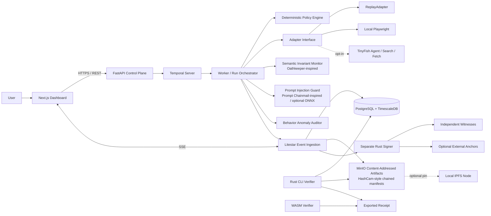

# Agent Black Box: Design

**Based on:** `Agent_Black_Box_Final_Architecture_v9_ML_Integrated.md` (v9)
**Related:** `REQUIREMENTS.md`, `PROTOCOL.md`
**Status:** DRAFT 0.2. This is a target design. Nothing in sections 2 to 21 is implemented or tested yet. Section 22 says what the current Python prototype already covers.
**Review changes:** an architecture review added decisions D-10 to D-19 (section 24). Items marked `(ext)` go beyond v9; D-10 and D-12 also change v9's checkpoint and signer flow.
**Claim status:** every statement about v9 behavior is `SPECIFIED`. Following v9 §22, none is `IMPLEMENTED`, `TESTED` or `MEASURED`.

---

## 1. Purpose and scope

Agent Black Box records what an automation run claims to have done, applies deterministic policy checks, optionally analyzes behavior with ML, and produces a receipt whose integrity can be checked independently (v9 §1).

It is an **evidence and behavioral-auditing system**. It is not a universal proof that an agent is honest or that a real-world action happened (v9 §18).

What a valid receipt proves: the signed event history has not been altered relative to trusted checkpoints, and the declared source and coverage of observations are recorded. Stronger claims about real execution need trustworthy observation or independent attestation.

## 2. Operating profiles

| Profile | Default | What runs | What is off |
|---|---|---|---|
| `LOCAL_ONLY` | yes | Execution, event recording, cryptography, storage and verification, all local. Works offline once images and models are downloaded | TinyFish, public anchors, remote witnesses |
| `CONNECTED_EVIDENCE` | no (opt-in) | Everything in `LOCAL_ONLY`, plus TinyFish Search/Fetch or Agent runs, independent witnesses, external anchors | nothing |

External services are adapters. They are never a requirement for core operation or for receipt verification.

**Zero-budget meaning:** no required hosted-service bill. Self-hosting still costs hardware, electricity, disk, bandwidth and maintenance time. TinyFish is optional and consumes credits, so budget guards are mandatory (section 13.3).

## 3. Technology stack (as specified in v9 §2)

| Concern | Choice | Notes |
|---|---|---|
| Web UI | Next.js, React, TypeScript, Tailwind CSS, shadcn/ui | Dashboard, run explorer, policy view, receipt viewer |
| API and control plane | FastAPI | Auth, run lifecycle, policy decisions, receipt endpoints |
| Event ingestion | Litestar | Dedicated service. Benchmark before tuning |
| Orchestration | Self-hosted Temporal | Durable workflows, retries, timers, cancellation, recovery |
| Adapters | ReplayAdapter first, local Playwright, optional TinyFish | Replay is deterministic and default |
| ML and security analysis | Python, scikit-learn, optional ONNX Runtime | Advisory only |
| Cryptographic core | Rust library and CLI | RFC 8785 JCS, SHA-256 Merkle tree, Ed25519 |
| Database | PostgreSQL with the open-source TimescaleDB extension | Protocol-critical rows stay relational |
| Artifact storage | Self-hosted MinIO | Content-addressed objects |
| Optional distribution | Local IPFS node | Not the source of truth |
| Live updates | Server-Sent Events | Replay with `Last-Event-ID` |
| Browser verifier | Rust compiled to WebAssembly | CLI stays authoritative |
| Local LLM | Optional Ollama profile | Not needed for baseline security decisions |
| Deployment | Docker Compose | Pinned images, health checks, limits, volumes, backups |

### 3.1 Hackathon cut (D-13)

The protocol does not change. Only the amount of infrastructure does. Build the **cut** first and grow toward full v9; each deferred piece sits behind an interface so it can be added later.

| Concern | Full v9 | Hackathon cut | Why |
|---|---|---|---|
| API plus ingestion plus SSE | FastAPI and Litestar as two services | **One FastAPI service** with an ingestion module | v9 itself says benchmark before tuning; no proof yet that two are needed |
| Database | PostgreSQL with TimescaleDB | **Plain PostgreSQL** | v9 keeps the ledger in plain tables anyway; avoids extension and license review |
| Orchestration | Temporal | **Postgres lease and fencing token** in the worker | Same safety rule (stale worker cannot commit), far less to run |
| Artifacts | MinIO, optional IPFS | **MinIO**, no IPFS | IPFS is optional by v9 |
| Verifier | Rust CLI and WASM | **Rust CLI first**, WASM later | The CLI is the authoritative verifier |
| Signer, global log, witness | Separate signer, 2-of-3 witnesses | **Separate signer kept**; one extra witness on a second device plus a Git anchor | The signer is the core idea; a second device is the cheapest real independence |
| Adapters | Replay, Playwright, TinyFish | Replay, then Playwright, TinyFish spike last | Playwright is the only path that can honestly reach `STEP_GATED` |
| ML | Anomaly auditor | Rules baseline; model is a stretch goal | No labeled data (section 14.4) |

**Demo story the cut must support:** run a replay scenario, show the receipt verifies, edit one event and one artifact, show the verifier name the broken point, delete a whole run, and show `abb verify-global` catch it.

## 4. Component diagram



The diagram shows logical responsibilities. It does not claim the containers or integrations exist yet.

## 5. Trust boundaries

| # | Component | Trust level | Rule |
|---|---|---|---|
| 1 | Browser and UI | Untrusted presentation | May show a false result if compromised. Never decides if a receipt is valid |
| 2 | FastAPI control plane | Trusted for auth and orchestration | Creates runs, evaluates request-level policy, starts workflows. No access to signer keys |
| 3 | Litestar ingestion | Trusted writer | Validates schema, sequence, idempotency, authorization, canonical encoding. Sole normal writer of committed event rows |
| 4 | Worker and adapters | **Untrusted for ledger integrity** | Propose observations and artifacts. Cannot rewrite committed events or call the signer with arbitrary roots |
| 5 | Signer | Isolated | Own process and key volume, narrow authenticated API, no general DB credentials. **Recomputes the root from the events itself** (D-12) and validates before signing |
| 6 | Database and object store | Durable, not immutable | A host administrator can rewrite them. Checkpoints, witnesses and anchors detect tampering or rollback |
| 7 | External adapters, witnesses, anchors | Outside the local boundary | Outputs labeled by provenance. Never called independent if they share administrator or machine |

## 6. Services and responsibilities

**FastAPI (control plane).** Authentication and authorization. Run creation and cancellation. Policy version selection. Temporal workflow start and query. Receipt export and verification jobs. Budget guard and TinyFish opt-in. Never exposes signer keys.

**Litestar (ingestion and SSE).** Schema and size validation. Authenticated event intake from adapters and workers. Idempotency, sequence assignment, transactional commit with outbox. SSE of committed events with replay. Rate limits and backpressure. No signing-key access.

**Temporal (orchestration).** Run lifecycle, timers, retries only where safe and idempotent, heartbeats, cancellation, recovery. Activities are idempotent. Ambiguous irreversible outcomes are reconciled, not retried.

**Worker.** Acquires the lease and fencing token, runs the policy engine, drives the adapter, calls the ML and security modules, proposes events.

**Signer.** Section 11.

**Artifact component.** The single path for uploads to MinIO (section 10).

## 7. Run lifecycle

1. The user creates a run with a task, adapter, policy version and requested coverage.
2. FastAPI validates it, records a run intent, and Temporal starts the workflow.
3. The worker takes a lease and fencing token and evaluates the deterministic policy.
4. The adapter runs a bounded task. Each observed or gated action becomes a proposed event. Artifacts go to MinIO through the artifact component.
5. Litestar validates and commits events in a transaction, assigning `(run_id, sequence)` and an idempotency key. SSE publishes only committed events.
6. The ML auditor analyzes metadata during or after the run. Its output is advisory and recorded separately.
7. Finalization freezes the event prefix, computes the Merkle root, and asks the signer to verify the extension from the previous checkpoint.
8. The signer persists its state, then returns a signature. Witnesses and anchors follow the selected profile.
9. The exporter builds the receipt.
10. The Rust CLI and the WASM verifier validate it independently. The browser verifier is never the only way.

States, legal transitions and the crash rules (no blind retry, `OUTCOME_UNKNOWN`, fencing) are in `PROTOCOL.md` section 6.

## 8. Coverage levels and truthful claims

| Level | Safe claim |
|---|---|
| `TASK_LEVEL` | Task-level reporting only |
| `STEP_OBSERVED` | Observed steps were recorded. Not every action is necessarily intercepted |
| `STEP_GATED` | Gated actions are policy-checked before execution, within the declared boundary |

Design rules:

- ReplayAdapter is simulation and is always labeled `REPLAY`.
- Playwright counts as `STEP_GATED` only when navigation, clicks, form submits, downloads and relevant network requests all pass through the gateway. Otherwise it is downgraded. A bypass test must prove the claim (section 19).
- TinyFish stays `TASK_LEVEL` or `STEP_OBSERVED` until the capability spike shows pre-dispatch gating for every in-scope action.
- Missing evidence is `UNKNOWN` or `INCOMPLETE`.

## 9. Data design

PostgreSQL holds protocol-critical rows. TimescaleDB hypertables are used only for time-series telemetry, and the event ledger stays in ordinary tables if an extension constraint complicates uniqueness (v9 §11).

Logical tables: `runs`, `run_state_transitions`, `event_stream_heads`, `events`, `event_idempotency`, `artifacts`, `policies` / `policy_versions`, `ml_assessments`, `checkpoints`, `witness_signatures`, `anchor_publications`, `workflow_outbox`.

Sketch only (not a migration):

```sql
-- events: exact signed bytes are stored, never rebuilt from JSONB
CREATE TABLE events (
  run_id          uuid    NOT NULL,
  sequence        bigint  NOT NULL,
  event_id        uuid    NOT NULL UNIQUE,
  event_type      text    NOT NULL,
  canonical_bytes bytea   NOT NULL,   -- JCS bytes (PROTOCOL.md section 3)
  leaf_hash       bytea   NOT NULL,   -- 32 bytes
  created_at_ms   bigint  NOT NULL,   -- a claim
  PRIMARY KEY (run_id, sequence)
);
CREATE TABLE event_stream_heads (
  run_id         uuid PRIMARY KEY,
  next_sequence  bigint NOT NULL,
  fencing_token  bigint NOT NULL,
  finished       boolean NOT NULL DEFAULT false
);
```

Rules:

- **One serialized writer per run.** The ingestion service runs `SELECT ... FOR UPDATE` on `event_stream_heads` in the same transaction that commits the next sequence and event.
- The event row, the head update and the outbox entry commit **atomically**.
- SSE reads only committed events and replays with `Last-Event-ID`.
- Application roles are least-privilege and the ingestion service owns normal event writes. This does not stop a database administrator, which is why checkpoints, witnesses and anchors exist.
- Review the TimescaleDB edition, license and constraint behavior for the chosen version before using hypertables.
- Tests: deletion, modification, rollback, backup restore and whole-database rollback (section 19).

### 9.1 Tables added by the review (D-10, D-11, D-16)

```sql
-- D-10: finalized runs, in the order they entered the global log
CREATE TABLE global_log (
  position        bigint PRIMARY KEY,         -- 0, 1, 2 ... leaf index in the global tree
  run_id          uuid   NOT NULL UNIQUE,
  record_bytes    bytea  NOT NULL,            -- JCS run-root record (PROTOCOL.md section 8.5)
  leaf_hash       bytea  NOT NULL
);
-- D-11: clear values and salts for committed fields, kept OUT of the ledger
CREATE TABLE field_disclosures (
  event_id   uuid NOT NULL,
  field      text NOT NULL,
  salt       bytea,      -- NULL after crypto-shredding
  value_json bytea,      -- NULL after crypto-shredding
  PRIMARY KEY (event_id, field)
);
-- D-16: approver public keys and mandates
CREATE TABLE approver_keys (key_id text PRIMARY KEY, public_key bytea NOT NULL, role text NOT NULL, status text NOT NULL);
CREATE TABLE mandates (mandate_id text PRIMARY KEY, mandate_bytes bytea NOT NULL, signature bytea NOT NULL);
```

Rules: `field_disclosures` has no foreign key into `events` and is restricted to the ingestion service and the receipt exporter. Deleting a salt must not touch the ledger. Backups of `field_disclosures` follow the same retention as the data they hide.

## 10. Artifact storage

- MinIO object key is derived from the artifact's SHA-256. Metadata and digest live in PostgreSQL.
- One designated artifact component accepts uploads. Workers send artifacts or a controlled upload request. They cannot overwrite objects or change committed metadata.
- Upload flow: temporary object, checksum verification, atomic metadata finalization, cleanup of abandoned uploads.
- The digest is verified after upload and again before export or download.
- Versioning and object-lock features are used only after validating the edition and license. They are not assumed to stop a host administrator.
- The artifact manifest (hash-linked, `PROTOCOL.md` section 9) is separate from the event Merkle tree. Its head is bound into the signed checkpoint.
- IPFS is optional. A CID is a locator, not a substitute for the signed receipt. The system works without IPFS.

## 11. Signer, witnesses and anchors

### 11.1 Signer

Separate process or container, dedicated persistent key volume, narrow authenticated API, no general DB credentials. Private keys are not mounted into any other container.

It signs only after validating a request that carries the stream identity, the previous signed checkpoint, and the canonical bytes of the new events (D-12). **The signer computes the new root itself** from a stored Merkle frontier and never signs a root supplied by the caller. It checks event encoding, sequence continuity, run identity and that nothing follows `RUN_FINISHED`. It cannot know the events are true; that is the job of the gateway, the witnesses and the anchors. Full rules, error codes and the state log are in `PROTOCOL.md` section 11.

Operations: generate keys offline where feasible, keep an encrypted offline backup, document and test restore and rotation. A single signer detects edits relative to its own retained state. It cannot defeat compromise of its host together with all backups, which is what witnesses and anchors are for.

### 11.2 Witnesses

Quorum is **2-of-3 independent witnesses in addition to the primary signer** (decision D-02). Each witness has separate keys and its own anti-rollback state, independently verifies extension, and then signs. If witnesses share an administrator or machine, the receipt states that they share a failure domain and `witness_quorum` reports `PARTIAL`.

Review additions (D-10, D-15): witnesses sign **global** checkpoints, not every run checkpoint. Each witness and the signer carry a `failure_domain` label. Two witnesses on the same machine or under the same administrator give `witness_quorum = NOT_INDEPENDENT`, never a green tick. The cheapest real independence is a second device (a teammate's laptop or a small VPS) running a witness.

### 11.3 Anchors

Minimum anchor (D-15): an append-only file in a public Git repository, one line per global checkpoint (`tree_size`, `checkpoint_hash`, `published_at`). It is cheap, public and easy to explain. It stays `NOT_INDEPENDENT` if it is in the same administrator's repository as the signer.


`CONNECTED_EVIDENCE` may publish checkpoint digests to a public Git repository, another administrator's repository, or a verified transparency or timestamp service. Git timestamps are not trusted timestamps. Anchors are out-of-band metadata, not run events. `LOCAL_ONLY` makes no external anti-rollback claim.

### 11.4 Global log of run roots (ext, D-10)

Each finalized run's last checkpoint is appended to one global log, signed by the same signer. Witnesses and anchors cover the global log, so a run that is deleted later leaves a gap that `abb verify-global` can find. Limits and the exact leaf layout are in `PROTOCOL.md` section 8.5. A run deleted before it enters the global log is not detected, so the worker finalizes and appends promptly.

### 11.5 Signed approvals and mandate (ext, D-16)

- The approver signs an approval statement on their own device. The control plane relays the signature and never holds approver keys (`PROTOCOL.md` section 5.6).
- An optional **mandate** (allowed hosts, action types, action count, spend limit, expiry) is signed by the issuer and referenced from `RUN_STARTED`. The gateway uses it as a deterministic policy input; the verifier re-checks it (`mandate_compliance`).
- Both are evidence of who allowed what. They are not proof of which human held the key.

## 12. Deterministic policy engine

- Decisions are deterministic and versioned, and each run records the exact policy version.
- Mechanisms: allowlists and denylists, action constraints, domain restrictions, rate limits, human approval gates, explicit high-risk action handling.
- Each decision records policy ID and version, input digest, decision, reason codes and approval reference (`ACTION_AUTHORIZED`, `ACTION_BLOCKED`).
- The engine sits in the execution path for `STEP_GATED`.
- ML scores never override a deterministic deny and never authorize an action.
- High-risk findings from the ML modules can cause a block or approval request only through an explicit deterministic policy rule.

## 13. Adapters and TinyFish

### 13.1 Adapter contract

Every adapter returns `adapter_name`, `adapter_version`, `execution_id`, `requested_coverage`, `observed_coverage`, `started_at`, `finished_at`, `status`, `steps[]`, `artifacts[]`, `errors[]`, `external_usage`, `provenance`. The schema separates `reported_by_adapter`, `observed_by_local_gateway` and `verified_by_black_box`.

### 13.2 Adapter roles

| Adapter | Role | Notes |
|---|---|---|
| ReplayAdapter | Default, zero cost, deterministic | Always labeled `REPLAY` |
| Local Playwright | Main real-browser path | `STEP_GATED` only if proven |
| TinyFish | Optional, credit-limited | Needs explicit opt-in. Capped at `STEP_OBSERVED` until a capability test proves pre-dispatch gating (D-14) |

**Coverage story (D-14).** We gate local agents and observe remote ones, and the receipt says which. Local Playwright is the hero path because only a local gateway can truly sit before dispatch. For declared `STEP_GATED` the verifier also checks that every `ACTION_DISPATCHED` has an earlier `ACTION_AUTHORIZED` for the same action.

### 13.3 TinyFish budget policy

- Hard project-wide ceiling from actual provider metering, not guessed counts.
- Before each run: opt-in, usage estimate if the API supports it, remaining-credit check if exposed.
- Stop optional calls at the reserve threshold. No silent paid fallback.
- Record operation type, provider execution ID, metering data and observation time.
- Handle quota exhaustion gracefully.
- No broad crawls or uncontrolled agent loops.

Initial $15 planning allocation (limits, not price estimates): Agent tests $6, Search/Fetch tests $3, evidence validation and reruns $3, reserve $3.

Capability spike before classifying TinyFish coverage: per-step records and identifiers, screenshot/HTML availability and retention, timestamp semantics, errors and cancellation, real credit use, quotas and exhaustion behavior, pre-execution gating, and terms for keeping and exporting evidence.

## 14. ML and security modules

All four modules are advisory. They never sit inside the cryptographic path and never grant permission.

### 14.1 Semantic invariant monitor (Oathkeeper-inspired)

This is the Oathkeeper research approach, not Ory Oathkeeper. It detects a run that reports success while breaking the workflow's expected behavior.

1. Start with deterministic invariants written from task requirements.
2. Build regression scenarios with known-good and known-bad traces.
3. Evaluate invariants on live traces and point to the failing event range.
4. Missing or unobserved steps are `UNKNOWN`, never a pass.
5. Mining candidate invariants comes later and is human-reviewed.

Example invariants: success needs an observed postcondition; a destructive action needs approval before dispatch; a reported success cannot have only a failed or unknown outcome; declared `STEP_GATED` needs evidence the gateway intercepted every in-scope action.

Emits `SEMANTIC_INVARIANT_CHECKED` and `SEMANTIC_VIOLATION_DETECTED`.

### 14.2 Artifact provenance (HashCam-style)

Cryptographic, not ML. Capture, hash raw bytes, store content-addressed, verify, append a hash-linked manifest entry, bind the manifest head into the checkpoint, verify offline. Limits: a hash proves bytes match a digest, not that the screenshot is genuine. A compromised capture process can fabricate evidence before hashing. Local timestamps are claims.

### 14.3 Prompt-injection guard (Prompt Chainmail-inspired)

Screens untrusted page text, fetched documents, accessibility-tree content and tool outputs before they become agent context.

1. Keep a digest or reference of the original input and apply size limits.
2. Deterministic checks for injection patterns, role confusion, hidden instructions, tool-use hijacking.
3. Optional local ONNX classifier.
4. Emit `ALLOW`, `FLAG_FOR_REVIEW` or `BLOCK_BY_POLICY` as a signal to the policy gateway.
5. Record detector or model version, score, reason codes, source digest, coverage.
6. If the classifier is unavailable, fall back to deterministic checks and record that.

**Default (D-17): deterministic checks only. The classifier is off unless explicitly enabled after a license review.** No Prompt Chainmail code or model is copied or vendored. Only the `classify(input) -> verdict, score, reasons` adapter interface is kept, so any suitably licensed model can be plugged in later. Receipts record `classifier_available = false` while it is off.

Prompt Chainmail's public repository describes its classifier as development-quality and lists Business Source License 1.1 with a future Apache 2.0 conversion. It is a candidate reference, not an approved dependency. Inspect the exact revision, model artifact, license and release status first. If unsuitable, keep the adapter interface and use a suitably licensed or locally trained model. Evaluate with benign hard negatives (security docs, quoted attacks, code blocks) and attacks, and report false positives and negatives. It is not a complete solution.

### 14.4 Behavior anomaly auditor

Interpretable baselines first. Candidate features: step and action counts, loops and retry bursts, dwell times, navigation/reading/action ratios, action n-grams, outcome and error patterns that are not policy-derived. Never use "policy violation" or "off-allowlist" as inputs (circularity). Compare rules, Isolation Forest, and a supervised model only if labels exist. Split by scenario family and time. Report precision, recall, false-positive rate, calibration where applicable, and per-scenario results. Scores are not probabilities unless calibrated. Receipts carry only model, version and feature-schema identifiers and metadata, never executable models.

**Status (D-18): stretch goal.** There is no labeled data, so the first version is a rules baseline (loop and retry bursts, step-count outliers) and the model comes after the demo works. It is advisory, never in the trust path, and the demo does not depend on it.

### 14.4a Replay drift (ext, D-19)

Run the same task twice (or replay a stored run) and diff the normalized traces: actions added, removed or reordered, hosts that differ, outcome that changed. The result is an advisory `BEHAVIOR_ANOMALY_ASSESSMENT` record. It shows when an agent behaves differently on identical input, which is useful for regression testing and drift. It is not proof of anything malicious.

### 14.5 Separate assessment channels

The UI and receipt show these separately: `POLICY_ASSESSMENT`, `SEMANTIC_ASSESSMENT`, `PROMPT_SECURITY_ASSESSMENT`, `BEHAVIOR_ANOMALY_ASSESSMENT`, `EVIDENCE_INTEGRITY`. An anomaly is not proof of malice. An injection score is not proof an attack worked. A valid hash is not proof the content is true.

### 14.6 Reference projects (to confirm before any dependency)

- Oathkeeper research paper (semantic invariant inference), USENIX OSDI 2022
- Ory Oathkeeper (a separate identity-aware proxy, not an ML detector)
- HashCam hash-chaining-camera reference (`bochristopher/hash-chaining-camera`)
- Prompt Chainmail (`prompt-chainmail/prompt-chainmail-ts`)
- CHAINMAIL on-chain communication project (distinct from Prompt Chainmail)

None is vendored or validated here.

## 15. Receipts and verification

Receipt contents and the verifier procedure are in `PROTOCOL.md` sections 15 and 16. Design points:

- One Rust core drives the signer, the CLI and the WASM build. Wrappers never reimplement cryptographic rules.
- The CLI is the reference. It verifies locally exported receipts.
- WASM verifies a user-selected local receipt with size limits, path-traversal defenses, bounded decompression, safe parsing and rejection of unknown critical fields.
- Subresource Integrity does not defeat a compromised page that can change both script and integrity value. So a separate CLI or offline verifier build is published with its digest and key through an independent channel.
- Output is a set of dimensions plus an overall result (`VALID`, `INVALID`, `INCOMPLETE`, `UNSUPPORTED`, `PARTIAL`). Which dimensions are required depends on the profile (D-19, `PROTOCOL.md` section 16.1): `INCOMPLETE` means something required is missing, `PARTIAL` means only something optional is. The two dimensions added by the review are `global_log_inclusion` and `mandate_compliance`. A valid signature never means the task was safe, correct, authorized or executed as claimed.
- Dependencies are pinned and builds are reproducible where practical.

## 16. UI design

Target stack: Next.js, React, TypeScript, Tailwind, shadcn/ui.

Screens:

| Screen | Purpose |
|---|---|
| Dashboard | Runs, states, coverage, recent findings |
| Run explorer | Live event timeline over SSE with replay |
| Policy view | Policy version, decisions, approvals |
| Receipt viewer | Drop a receipt, see every verifier dimension and the overall result |
| Assessments | Five channels shown separately with provenance and coverage |

Design direction: calm audit-dashboard look, a large pass or fail banner, a hash-chain or tree visual with the broken point marked when a check fails, responsive layout, contrast 4.5:1, visible focus, reduced motion respected. Every card shows the claim status, coverage level and whether data is `REPLAY`.

The UI is untrusted. It shows what the verifier says and links to the CLI verifier for an independent check.

### 16.1 UI additions from the review

- **Approval screen (D-16):** shows exactly the summary whose digest is signed, and asks the approver's own device to sign. The browser never shows "approved" until the signed event is committed.
- **Mandate editor (D-16):** pick allowed sites, action types, limits and expiry, then sign.
- **Receipt viewer:** show `NOT_INDEPENDENT` as an amber state with the reason ("both witnesses are on this machine"), not as pass or fail. Show hidden fields as locked, with "disclose" when the salt is available.
- **Global log view:** list of runs in the global log, the latest witnessed or anchored checkpoint, and the result of `abb verify-global`.
- Per the standing preference, recommend UI tools (and ask which one) before building the website UI.

## 17. Deployment and operations

Compose profiles: `core` (frontend, FastAPI, Litestar, worker, PostgreSQL/TimescaleDB, Temporal, signer, MinIO), `replay`, `playwright`, `tinyfish` (config only, no secrets committed), `ipfs`, `llm`, `testing`.

Requirements:

- Pin images by digest where feasible. Health checks, startup ordering, migrations, resource limits, non-root users, least-privilege credentials.
- Signer key volume separate and never mounted elsewhere. Signer ingress limited to authenticated ingestion and checkpoint requests.
- PostgreSQL, MinIO, Temporal and signer ports not public by default.
- Secrets in local secret files or a suitable mechanism. API keys never committed.
- Back up PostgreSQL, MinIO artifacts, signer state, keys and verifier public-key manifests. Test restore.
- Retention limits, log redaction, disk-space alerts, safe shutdown.
- Document which optional profiles need internet.

## 18. Threat model

**Designed to detect:** changes to retained canonical events after a trusted checkpoint; invalid signatures and malformed proofs; some rollback or fork attempts when signer state, independent witnesses or external anchors stay trustworthy; artifact substitution when digests are checked; policy decisions that lack required approval or evidence.

**Not guaranteed to detect:** actions the adapter or gateway never observed; a compromised execution host that fabricates observations before they enter the ledger; collusion or compromise of all signers and witnesses and their state; rollback when one machine and all backups roll back together; the truth of a timestamp without a trusted source; correctness or safety of an outcome just because a receipt verifies; provider behavior beyond the evidence returned.

## 19. Test and release gates

A capability is not labeled `TESTED` until CI or a reproducible local test proves it.

| Area | Must cover |
|---|---|
| Protocol and crypto | JCS vectors and rejections; hash and domain-separation vectors; inclusion and consistency proofs for empty, single, power-of-two and irregular sizes; signatures, rotation, genesis, malformed input; Rust CLI versus WASM agreement |
| Storage and concurrency | Concurrent writers on one run; duplicate delivery; stale worker fencing; crash between upload, metadata commit, event commit and checkpoint; DB restore and rollback; artifact corruption and loss |
| Signer and witnesses | Arbitrary-root attempts; missing or duplicate sequences and forks; state corruption and recovery; quorum with unavailable or colluding witnesses; accurate independence documentation |
| Adapters and ML | Replay determinism; Playwright coverage and bypass; TinyFish quota, timeout, malformed response, provenance; no paid fallback when exhausted; ML baseline comparison and false-positive reporting |
| Security and deployment | Authorization and tenant isolation before multi-tenancy; SSRF and untrusted URLs; upload, path and decompression safeguards; secret scan, dependency audit, image pinning, backup and restore; Compose start and clean shutdown from a fresh checkout |

## 20. Implementation sequence (v9 §21)

1. Freeze the protocol: `docs/PROTOCOL.md`, schema versioning, canonical bytes, tree algorithm, checkpoint layout, test vectors.
2. Rust core and CLI: JCS, SHA-256 tree, Ed25519, proofs, receipt verifier.
3. PostgreSQL/TimescaleDB and Temporal: migrations, run state, stream head, outbox, leases and fencing.
4. FastAPI and Litestar: endpoints, ingestion, transactional commit, SSE replay.
5. Signer: separate key volume, append validation, anti-rollback state, recovery procedure.
6. ReplayAdapter and policy gateway: deterministic scenarios, honest coverage labels.
7. MinIO artifact flow: digest validation, metadata, cleanup, receipt export.
8. Local Playwright: bounded runs and tests that show whether `STEP_GATED` is justified.
9. TinyFish capability spike under the $15 plan, integration kept optional.
10. Witnesses and anchors: independent state, explicit quorum, both profiles.
11. Semantic invariant monitor: deterministic invariants and regression traces first.
12. HashCam-style manifests: hash-link artifacts, bind the head into checkpoints.
13. Prompt-injection guard: adapter interface and deterministic checks first, ONNX only after license review and evaluation.
14. Behavior anomaly auditor: baseline first, then measured models, no authorization role.
15. Dashboard and WASM verifier: each assessment separate, with provenance, coverage and receipt inspection.
16. Hardening: threat tests, backup and restore, license review, reproducible release.

### 20.1 Hackathon order (D-13)

1. Protocol freeze for the parts used first (JCS, tree, checkpoints, global log) with test vectors.
2. Rust core and CLI, including `abb verify-global`.
3. Plain PostgreSQL, a single FastAPI service with ingestion, lease and fencing.
4. Separate signer that recomputes roots (D-12).
5. ReplayAdapter, policy gateway, receipt export, **tamper demo** (edit an event, edit an artifact, delete a run).
6. MinIO artifacts and the manifest.
7. Local Playwright with real gating tests (D-14).
8. Global log witness on a second device and the Git anchor (D-10, D-15).
9. Signed approvals, then the signed mandate (D-16), and field commitments (D-11).
10. Semantic invariants, deterministic prompt guard, dashboard.
11. TinyFish spike (observed only), replay drift, rules baseline for anomalies; then the ML model if time remains.
12. Later: Temporal, Litestar split, Timescale telemetry, IPFS, WASM, hardening.

## 21. Claims ledger

Every README and demo claim has exactly one status: `SPECIFIED`, `IMPLEMENTED`, `TESTED`, `MEASURED` or `UNVERIFIED`. Today every v9 implementation and security claim is `SPECIFIED` or `UNVERIFIED`. Do not claim: the signer prevents forks; the system detects rollback; Playwright is fully gated; TinyFish exposes step-level evidence; semantic invariants catch real violations; the prompt classifier is production-ready; ML beats a baseline; artifact capture is genuine; CLI and WASM agree. Each needs its tests and evidence first.

**Acceptance criterion:** a fresh local deployment can run a replay scenario, run deterministic policy and semantic checks, hash-link a captured artifact, record canonical events, create and verify a signed checkpoint, export a receipt, detect event and artifact tampering, and explain coverage limits, with no paid service or external ML API.

## 22. Prototype mapping and migration

The current Python prototype (about 20 source files, 21 pytest tests) is a working proof of the core idea. It is not v9. Its Docker files were never run and it has no real TinyFish client.

| Prototype module | What it does | v9 target | Gap |
|---|---|---|---|
| `ledger/canon.py` | `json.dumps` with sorted keys, no spaces, UTF-8, NaN rejected | RFC 8785 JCS in Rust | Not JCS: Python sorts keys by code point while JCS sorts by UTF-16 code unit (differs above U+FFFF), floats are allowed, and number formatting differs. Needs a JCS implementation and integer-only validation |
| `ledger/chain.py`, `verify.py` | Linear hash chain, Ed25519 signature on every entry | Merkle tree plus signed checkpoints from a separate signer | Different structure and signing model. The tamper-detection idea carries over |
| `ledger/store.py` | SQLite insert-only, screenshots saved by SHA-256 (atomic rename) | PostgreSQL ledger plus MinIO objects | Storage change. Atomic write and content-addressing ideas carry over |
| `ledger/anchor.py` | Entry count and tip hash published (gist), truncation check | Checkpoint digest anchors and witnesses | Wider: needs quorum, independence rules |
| `ledger/mask.py` | Regex masking of card, OTP, password | Redaction plus optional ML PII detection | Keep, extend |
| `ledger/api.py` | FastAPI: runs, entries, verify, payment approve, Bearer tokens | FastAPI control plane plus Litestar ingestion | Split in two services |
| `agent/run_step.py` | Single gateway: step limit, guard, record, masked output | Policy gateway plus adapter interface with coverage labels | Add adapter contract, event types, coverage |
| `agent/graph.py` | LangGraph plan then act loop | Worker under Temporal | Orchestration moves to Temporal |
| `guard/policy.py` | Site and recipient allowlists, spend limit, approval for sensitive actions | Versioned deterministic policy engine | Add versions, recorded decisions, domain pinning |
| `payment/payment.py` | Pending, approved, 30 s cooling, sent or cancelled, testnet signer function | Not in v9 | Optional extension (section 23) |
| `ui/index.html`, `ui/api.py` | Plain HTML verify and tamper demo | Next.js UI with WASM verifier | Rebuild |
| `Dockerfile`, `docker-compose.yml` | Single UI service plus placeholder agent | Compose profiles | Never run. `COPY . .` risks copying `secrets/`, so a `.dockerignore` is needed first |

Migration approach (decision D-09): keep the prototype as a runnable demo and reference for behavior. Build v9 in the slices of section 20. Do not migrate the prototype in place.

## 23. Optional extension: human-approved payment (not in v9)

v9 has no payment flow. The prototype does, and it fits the v9 event model, so it is kept as an optional module (decision D-08). Testnet only. It needs your confirmation.

| Step | v9 event |
|---|---|
| Agent prepares a request | `ACTION_REQUESTED` (action type `pay`) |
| Policy checks recipient allowlist and limit | `ACTION_AUTHORIZED` or `ACTION_BLOCKED` |
| Human is asked on a separate screen | `HUMAN_APPROVAL_REQUESTED` |
| Human approves or denies | `HUMAN_APPROVAL_GRANTED` or `HUMAN_APPROVAL_DENIED` |
| Cooling period (30 s default), cancel possible | cancel recorded as `ACTION_FAILED` with `error_code = CANCELLED_BY_USER` |
| Testnet wallet signs | `ACTION_DISPATCHED`, then `ACTION_SUCCEEDED` or `ACTION_FAILED` |

With D-16, the human approval in this flow is a **signed** approval (`PROTOCOL.md` section 5.6), and the payment limit can come from a signed mandate.

Rules kept from the prototype: the agent has no send function; recipient and amount come from the stored row, not from agent input; mainnet is never enabled.

## 24. Decisions

| ID | Decision | Where |
|---|---|---|
| D-01 | RFC 6962 Merkle tree hash over protocol-defined leaves | `PROTOCOL.md` §8 |
| D-02 | Quorum is 2-of-3 independent witnesses plus the primary signer | `PROTOCOL.md` §12, section 11.2 |
| D-03 | Artifact digest has no domain tag | `PROTOCOL.md` §4 |
| D-04 | Receipt is a ZIP with `receipt.json` | `PROTOCOL.md` §15 |
| D-05 | Overall-result precedence | `PROTOCOL.md` §16.2 |
| D-06 | Proposed size and depth limits | `PROTOCOL.md` §3.3 |
| D-07 | Run-state transition table | `PROTOCOL.md` §6 |
| D-08 | Keep the payment flow as an optional extension | Section 23 |
| D-09 | Keep the prototype as a demo, build v9 in new slices | Section 22 |
| D-10 | Global log of run roots; witnesses and anchors cover it (ext) | `PROTOCOL.md` §8.5, section 11.4 |
| D-11 | Salted field commitments; crypto-shredding (ext) | `PROTOCOL.md` §5.5, section 9.1 |
| D-12 | Signer recomputes roots from events and a frontier | `PROTOCOL.md` §11, section 11.1 |
| D-13 | Hackathon cut of the stack and build order | Sections 3.1 and 20.1 |
| D-14 | `LIVE_EXTERNAL` capped at `STEP_OBSERVED`; dispatch needs earlier authorization | `PROTOCOL.md` §7, section 13.2 |
| D-15 | `failure_domain`, `NOT_INDEPENDENT`, Git anchor | `PROTOCOL.md` §12, §13, section 11.2 |
| D-16 | Signed approvals and optional signed mandate (ext) | `PROTOCOL.md` §5.6, §5.7, section 11.5 |
| D-17 | Prompt guard deterministic by default; classifier off | Section 14.3 |
| D-18 | Anomaly auditor is a stretch goal | Section 14.4 |
| D-19 | Required vs optional dimensions; replay drift | `PROTOCOL.md` §16, section 14.4a |

All nineteen are proposals for your review.

## 25. Appendix A: product notes (non-normative)

These came from our discussion. They are not v9 requirements and none is built.

**Where it fits.** Strongest: banking and fintech, insurance, accounting and CA firms, vendor payments and procurement, IT operations. Good: government and tender portals, real estate, education, e-commerce seller portals, supply chain, telecom and utilities, healthcare administration, HR and payroll filings, pharma regulatory, legal and compliance, digital ads, travel and logistics. Weak: API-only flows, real-time trading, creative work, clinical decisions.

**Adoption.** Buyers are compliance or audit heads, CISOs and finance heads. Plan: a free pilot on one small process (2 to 4 weeks), self-hosted first, paid later by agent or support contract (prices not set). Trust position: "do not trust us, verify". The verifier is open source, runs offline with only the public key, and the customer keeps the private key. Missing for real credibility: an independent security audit, a pilot customer, compliance mapping from a legal advisor, KMS or HSM key storage and real user auth.

**Ideas that extend v9 (novelty not verified).**
- Signed mandate: now specified as D-16 (`PROTOCOL.md` section 5.7). Specified only, not built.
- Selective disclosure: now specified through salted field commitments (D-11) on top of v9's Merkle inclusion proofs. Specified only, not built.
- Agent trust score from verified past runs.
- Replay for drift: now section 14.4a (D-19).
- Revocable short-lived agent keys.

**Name.** Still open. Candidates discussed: Hashcam, Dashcam, Chainmail, Cairn, Indelible, Oathkeeper, Gatekeeper, Provn, Sakshya, Proof of Action. Availability is not checked. Note that v9 already uses Oathkeeper, HashCam and Chainmail as names of reference projects, so reusing them as the product name could confuse readers.
